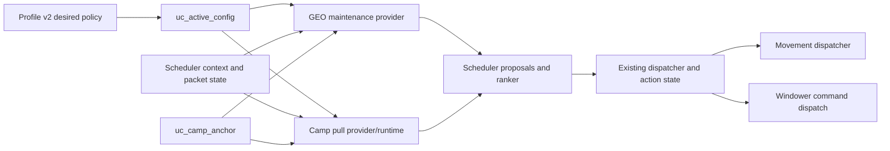

# RFC: Geomancer Maintenance and Job-Agnostic Camp Pulling

Status: Draft for review

Date: 2026-07-29

Scope: UnifiedCombat runtime, scheduler, profile-v2 configuration, and WinForms UI

## 1. Summary

UnifiedCombat should add two independently configurable capabilities:

1. A real Geomancer maintenance provider that maintains configured Geo and Indi
   spells and coordinates optional Entrust and luopan-enhancement actions.
2. A job-agnostic camp-pulling workflow that selects mobs, approaches into
   action range, uses a configured spell or job ability, waits for game
   acknowledgement, and returns the puller to the shared camp anchor.

These capabilities must remain separate:

- GEO maintenance is owned by the maintenance domain and is eligible only for a
  GEO main job.
- Camp pulling is owned by the combat and movement domains and may be enabled
  for any job that can use the configured pull action.

The implementation must build on UnifiedCombat's existing scheduler, action
state, pending-action handling, command dispatcher, movement dispatcher,
targeting helpers, camp anchor, and pull-action execution. It must not port the
standalone GEO addon's monolithic engine loop or introduce a second scheduler.

## 2. Source and repository baseline

This RFC was produced from the current working trees on 2026-07-29.

### Standalone GEO source

Inspected:

- `C:/Program Files (x86)/Windower/addons/Geo/Geo.lua`
- `C:/Program Files (x86)/Windower/addons/Geo/ReadMe.md`
- `C:/Program Files (x86)/Windower/addons/Geo/STALL_PREVENTION_TRACKER.md`

The GEO repository was dirty during inspection:

- `Geo.lua` modified
- `STALL_PREVENTION_TRACKER.md` modified
- current checked-out commit: `bce5b40`

The current working-tree behavior, not only commit `bce5b40`, is the behavioral
reference for this RFC. This matters because most of the pull-stall prevention,
prediction, collision, breadcrumb, and observability work is present in the
uncommitted `Geo.lua`.

### UnifiedCombat source

UnifiedCombat was also dirty during inspection:

- `tests/replay/harness/selftest_scheduler_spell_interruption_action_state.lua`
- `uc_scheduler_action_state.lua`
- `unified_scheduler.lua`

Those changes are unrelated to this RFC and were not modified.

## 3. Current-state findings

### 3.1 UnifiedCombat GEO maintenance is not executable

`uc_provider_maintenance.lua` currently:

- counts player buffs whose resource names begin with `Indi-` and `Geo-`;
- emits provider `geo`;
- emits placeholder action `maintenance_geo`; and
- reports `geo_missing`.

There is no matching GEO dispatch branch in `unified_scheduler.lua`. The
repository already documents this limitation in
`RFC/UnifiedCombat_scheduler_refactor_phase5_maintenance_cutover_checklist.md`.

The current branch is therefore a proposal scaffold, not working GEO
maintenance. It also uses the wrong primary signal for Geo bubble existence:
the standalone GEO addon treats luopan presence as the bubble signal, while the
UnifiedCombat scaffold counts player buffs.

### 3.2 UnifiedCombat already has a job-agnostic pull-action path

The existing path-hunter pull flow already supports a configured spell or job
ability without checking for GEO:

- `uc_provider_target_control.lua` emits `pull_control` proposals.
- `unified_combat_core.lua` resolves the configured action, validates learned
  spells, recast, MP, target validity, claim state, and range.
- `uc_scheduler_pull_executor.lua` routes target selection, movement, stop, and
  command intents through the dispatcher.
- Pull spells stop and settle before casting.
- Pull spell completion and failure are observed from action and action-message
  packets.
- `uc_pathing.lua` yields route movement during pull approach and spell wait.
- The movement coordinator honors pull cast-hold and spell-wait locks.

The current pull path is nevertheless tied to both `hunter` and
`path_follow_enabled`. It is suitable for route hunting, not stationary
camp-pulling. It does not implement a camp pull quota, early-replenish
threshold, outward journey, or return-to-camp state.

### 3.3 The shared camp anchor already exists

`uc_camp_anchor.lua` already owns:

- setting the current coordinate;
- sharing the coordinate over IPC;
- zone validation;
- current anchor resolution; and
- fail-closed reason codes for unavailable or invalid geometry.

The puller-distance gate in `unified_combat_core.lua` can already use this camp
anchor to decide whether other characters should approach a mob. Camp pulling
should use the same anchor. It must not create a second `home` coordinate.

## 4. Goals

### 4.1 GEO maintenance goals

The GEO subsystem will:

- maintain one configured Geo spell;
- maintain one configured Indi spell;
- support enemy-, self-, and named-party-member Geo targets when allowed by
  the selected spell resource;
- optionally apply Entrust and one configured Indi spell to one named party
  member;
- optionally coordinate Full Circle, Blaze of Glory, Ecliptic Attrition, and
  Life Cycle around luopan maintenance;
- optionally support a deliberately armed one-shot Bolster action;
- detect luopan presence and HP from scheduler pet context;
- use exact configured spell identities;
- defer ordinary maintenance while a camp pull is active;
- finish a consumed-ability sequence safely if it has already started;
- emit at most one scheduler proposal per evaluation;
- use packet/action evidence to advance or fail sequences; and
- expose explicit reason codes and runtime status.

### 4.2 Camp-pulling goals

The pulling subsystem will:

- be configurable for any main job;
- use the shared camp anchor;
- maintain a configured number of active, alliance-claimed mobs at camp;
- optionally begin the next pull when an active mob falls below a configured
  HPP threshold;
- select only configured, valid, alive, unclaimed pull candidates;
- rank candidates deterministically by configured priority, distance from camp,
  and entity ID;
- enforce a camp-relative pull leash and vertical-distance limit during both
  selection and movement;
- approach into a safe action range using the existing movement dispatcher;
- stop and settle before spell casts;
- wait for action acknowledgement without blocking scheduler ticks;
- classify recast, MP, status, range, invalid-target, claim, and server-reject
  conditions;
- return to camp after the target reacts to the pull;
- retain outward breadcrumbs for deterministic return;
- apply bounded retry, timeout, and per-target cooldown behavior; and
- produce structured pull diagnostics.

## 5. Non-goals

This RFC does not propose:

- copying the standalone GEO addon as a dependency;
- running the standalone GEO addon and UnifiedCombat GEO maintenance
  simultaneously;
- importing its display overlay, kill counters, HealBot commands, Devotion
  command, Convert behavior, tank Flash behavior, debuff tracker, or Swarmspawn
  nuking;
- adding a second engine loop, `prerender` behavior controller, command
  dispatcher, or movement owner;
- blocking `while` loops or `coroutine.sleep` polling sequences;
- guessing spell names, targets, action types, action ranges, or invalid
  configuration values;
- automatically spending Bolster from a durable always-on setting;
- writing luopan HP, active spell identity, target IDs, sequence state, or pull
  journey state into profile files;
- replacing route hunting; or
- changing existing path-hunter behavior as part of the first implementation
  phase.

## 6. Behavioral inventory and disposition

### 6.1 GEO behavior

| Standalone GEO behavior | Disposition in UnifiedCombat |
| --- | --- |
| Cast configured Geo spell when no luopan exists | Implement in dedicated GEO maintenance provider |
| Enemy Geo targets use an active combat mob | Track live party/alliance-claimed enemies in scheduler context, select by entity ID, and never depend on the selected game target |
| Self or named-party Geo target | Implement only when resource target metadata permits it |
| Maintain Indi when Indi-Colure is absent | Implement using local buff evidence plus exact runtime identity |
| Entrust JA followed by configured Indi on a party member | Implement as an atomic, nonblocking sequence |
| Full Circle before deliberate luopan replacement | Implement as an explicit replacement sequence |
| Blaze of Glory before Geo cast | Implement as optional sequence policy |
| Ecliptic Attrition after luopan creation | Implement as optional post-cast action |
| Life Cycle below luopan HPP threshold | Implement as a high-urgency maintenance proposal |
| Recreate luopan if it is too far from the desired placement | Implement against the shared camp anchor when configured |
| Boss mode orders Geo before Indi/Entrust | Replace with explicit scheduler priority and `geo_first` policy |
| Bolster toggle | Replace with explicit runtime one-shot arm |
| Blocking waits until JA buff/cast/pet state changes | Do not port; use pending state and packet/tick evidence |
| Temporarily disable HealBot around sequences | Do not port; scheduler action ownership already serializes actions |

### 6.2 Pull behavior

| Standalone GEO behavior | Disposition in UnifiedCombat |
| --- | --- |
| Pull until configured fight count is met | Implement as camp pull quota |
| Pull early when an active mob is below threshold | Implement as early-replenish policy |
| Configured mob names with numeric priorities | Implement in camp-pulling policy |
| Clear mode pulls any eligible mob | Defer; initial camp mode requires an explicit target list |
| Alliance-aware friendly claim set | Reuse `uc_targeting_common` |
| Reject invalid, dead, claimed, and out-of-leash targets | Reuse and extend current target/pull validation |
| Spell or JA pull action | Reuse current pull action handling |
| Learned spell, recast, MP, range, and status checks | Reuse scheduler/action readiness |
| Comfort range and pre-cast settle | Reuse current buffered range and settle flow |
| Cast acknowledgement and movement lock | Consolidate on scheduler action state and pending action lifecycle |
| Silence pauses spell pulling | Implement action-specific status gating; a legal JA is not blocked only because Silence is present |
| Retry budget and target cooldown | Reuse scheduler rejection/pending concepts and existing hunter cooldown behavior |
| Home position | Replace with `uc_camp_anchor`; do not create another coordinate owner |
| Return after target is claimed or damaged | Implement as `WAIT_REACTION -> RETURN` transition |
| Breadcrumb return | Implement in generic pull runtime through movement intents |
| Predicted cast point for moving targets | Phase after basic camp pulling; extend pure geometry helpers rather than copying actor movement code |
| Learned collision zones and slide-around recovery | Do not port initially; first reuse the existing movement stuck-recovery behavior and collect field evidence |
| Pull decision ring buffer and reason tags | Implement through existing scheduler timeline/diagnostic output |
| `PULL_LOCK` outranks new GEO/Entrust work | Preserve through proposal priority and sequence admission rules |
| An already-started consumed-buff sequence finishes before pull | Preserve through an atomic GEO action lane |

## 7. Architecture

### 7.1 Ownership



Durable profile data owns desired policy. Runtime modules own observed game
state. The scheduler remains the only action arbitrator.

### 7.2 Proposed module boundaries

#### `uc_geo_maintenance.lua` — new

Owns:

- GEO policy validation;
- luopan/Indi/Entrust observations;
- exact runtime identity records;
- sequence state;
- one-action proposal selection;
- dispatch/rejection/result notifications; and
- GEO-specific diagnostics.

It must not send commands, move the player, sleep, or poll.

#### `uc_pull_runtime.lua` — new

Owns the generic pull journey:

- quota decision;
- candidate eligibility and deterministic ranking;
- target attempt and cooldown state;
- journey state;
- outward breadcrumbs;
- return-to-camp completion; and
- pull diagnostics.

It consumes explicit dependencies and emits an action or movement decision. It
does not call Windower directly.

#### Existing compatibility wrappers

Keep the public scheduler/core entry points stable:

- `unified_combat_core.select_pull_for_scheduler`
- `unified_combat_core.dispatch_pull_for_scheduler`
- `uc_scheduler_pull_executor`

Their internals may delegate to `uc_pull_runtime.lua`. Existing path-hunter mode
must continue through these wrappers until a separate migration proves parity.

### 7.3 Why GEO and pulling are not one module

The only interaction is arbitration:

- ordinary GEO work must not start while a pull is active;
- a GEO sequence that has consumed Entrust or Blaze of Glory must finish its
  required spell step before pulling resumes; and
- pulling may run on any job even when GEO maintenance is absent.

This interaction belongs in scheduler priority/lane policy, not in shared
configuration or a combined engine.

## 8. Durable configuration

The shapes below are normative for the RFC. UI labels may differ.

### 8.1 GEO maintenance

```lua
config.maintenance.geo = {
    enabled = true,
    geo_spell = "Geo-Frailty",
    geo_target = {
        kind = "current_enemy", -- current_enemy | self | party_member
        name = nil,             -- required only for party_member
    },
    indi_spell = "Indi-Haste",
    ordering = "geo_first",     -- geo_first | indi_first
    require_camp = true,
    camp_tolerance_yalms = 1.0,
    unknown_existing_policy = "wait_for_clear",
    entrust = {
        enabled = true,
        spell = "Indi-Fury",
        target_name = "Tankname",
    },
    luopan = {
        use_blaze_of_glory = true,
        use_ecliptic_attrition = true,
        use_life_cycle = true,
        life_cycle_hpp = 50,
        replace_out_of_position = true,
        max_camp_distance_yalms = 6.0,
    },
}
```

Rules:

- `enabled=true` requires an exact valid `Geo-` spell and exact valid `Indi-`
  spell.
- `geo_target.kind` must be compatible with the spell resource target set.
- `party_member` requires a non-empty durable name. Runtime entity IDs are
  resolved from the current party and are never serialized.
- Entrust requires an exact `Indi-` spell and target name.
- Numeric fields must be finite and inside documented bounds.
- Invalid enabled configuration is rejected with a specific validation error.
  It is not coerced to another action, target, or range.
- `unknown_existing_policy` initially supports only `wait_for_clear`.

The current loose `config.maintenance.geo` list has never driven executable
maintenance. Migration may deterministically recognize exact `Geo-` and
`Indi-` entries. Duplicate, missing, or unrecognized entries must produce a
profile validation error rather than selecting an arbitrary spell.

### 8.2 Camp pulling

```lua
config.combat.pulling = {
    enabled = true,
    mode = "camp",
    action = {
        type = "spell", -- spell | ja
        name = "Dia II",
    },
    targets = {
        { name = "Apex Crab", priority = 20 },
        { name = "Apex Pugil", priority = 10 },
    },
    match_mode = "exact", -- exact | substring
    max_active_mobs = 1,
    replenish_below_hpp = 20,
    leash_yalms = 35.0,
    max_z_delta = 2.0,
    cast_range_ratio = 0.90,
    settle_seconds = 0.40,
    reaction_timeout_seconds = 4.0,
    retry_limit = 2,
    retry_window_seconds = 2.5,
    target_cooldown_seconds = 20.0,
    camp_arrival_yalms = 0.75,
}
```

Rules:

- `enabled=true` requires a valid shared camp anchor at runtime, a non-empty
  target list, a valid action type, and an exact resource name.
- The action must be currently learned/available for the actor before dispatch.
- `max_active_mobs` is a positive integer.
- HPP is in the inclusive range `0..100`.
- Ratios and distances must be finite and explicitly bounded by the normalizer.
- Invalid `action.type` is an error. It is not changed to `ja`.
- Missing or malformed action range metadata is an action-readiness failure. It
  is not replaced with a guessed 10- or 20-yalm range.

Existing `config.movement.path.pull_action_*` settings continue to own route
hunting. They are not silently treated as camp-pulling settings. Both modes may
share normalized internal helpers, but only one pull journey may own the actor
at a time.

## 9. Runtime state

No state in this section is durable.

### 9.1 GEO runtime state

```lua
{
    desired_generation = 0,
    observed_luopan_id = 0,
    observed_luopan_hpp = 0,
    owned_geo_spell = nil,
    owned_indi_spell = nil,
    owned_entrust_spell = nil,
    owned_entrust_target_id = 0,
    enemy_target_id = 0,
    sequence = nil,
    next_retry_at = 0,
    last_result = "",
}
```

Exact identity is established only by a confirmed UnifiedCombat cast. A generic
Indi-Colure buff or an already-present luopan after addon load proves presence,
not exact identity.

When the configured policy is `wait_for_clear`:

- an existing unidentified Indi effect is left untouched until it clears;
- an existing unidentified luopan is left untouched until it disappears; and
- diagnostics report the unknown-identity hold.

This is a deliberate fail-closed state, not an inferred match.

### 9.2 Pull runtime states

```text
IDLE
  -> SELECT_TARGET
  -> APPROACH
  -> SETTLE
  -> SEND_ACTION
  -> WAIT_ACTION_RESULT
  -> WAIT_TARGET_REACTION
  -> RETURN_TO_CAMP
  -> IDLE
```

Terminal/recovery transitions:

- invalid/dead/claimed/out-of-leash target -> cooldown target -> select another;
- recast/MP/action-blocked -> remain at camp and retry when readiness changes;
- movement stall -> bounded movement recovery;
- action rejection -> retry within budget, otherwise cooldown target;
- reaction timeout -> cooldown target and return to camp;
- camp anchor missing or zone mismatch -> stop movement and fail closed;
- domain disabled, engine stopped, zoning, death, or logout -> stop and clear
  journey state.

## 10. GEO decision contract

The provider evaluates the following categories, returning at most one action.

### 10.1 Required observations

Reuse scheduler context for:

- player main job, status, buffs, MP, and ID;
- target and mob maps;
- pet/luopan ID, position, and HPP;
- party members and runtime IDs;
- spell and ability recasts;
- current action state; and
- pending action.

Use the existing `0x063` status snapshot for local buff presence/endtime and
`0x076` party buff presence where applicable. Use action/action-message packets
to confirm exact casts and sequence progress.

### 10.2 Priority and admission

1. A consumed-ability sequence continuation is highest GEO priority.
2. A currently active camp pull outranks starting new GEO work.
3. Life Cycle may be proposed at elevated maintenance urgency, but it does not
   interrupt an active pull.
4. Missing Geo and missing Indi use the configured `ordering`.
5. Entrust is ordinary maintenance and begins only when its target is valid and
   no pull is active.
6. Ecliptic Attrition is a post-bubble enhancement and may run after the
   required bubble is confirmed.

Before starting Entrust or Blaze of Glory, the GEO module asks whether a pull
proposal/journey is active. Blaze may start only after a live logical enemy ID
has been resolved. Once one of those consumable buffs is observed, the paired
spell owns an atomic GEO lane until success, explicit rejection, or timeout.

`current_enemy` is a logical fight target, not Windower `<t>`. The GEO provider
selects a live party/alliance-claimed enemy from the scheduler mob snapshot and
retains its entity ID for the sequence. If that enemy dies after Blaze is
consumed, the provider re-resolves another claimed fight target. When none
exists, the atomic lane enters an explicit enemy-wait state and admits only the
configured camp-puller workflow. The Geo spell is deferred while the
replacement mob is unclaimed or the character is away from the configured camp.
After the pull claims a replacement and returns the character to camp, the GEO
provider resolves that claimed mob from the scheduler snapshot and dispatches
the required spell directly by ID before normal actions resume.

### 10.3 Nonblocking sequences

#### Enhanced Geo creation

```text
normal creation when no luopan exists and Blaze is unavailable
  -> configured Geo spell

Blaze upgrade when a normal owned luopan exists and Blaze becomes ready
  -> Full Circle
  -> wait for luopan absence
  -> Blaze of Glory
  -> wait for JA success/buff
  -> configured Geo spell
  -> wait for spell success and luopan presence
  -> optional Ecliptic Attrition
```

Enabling Blaze of Glory does not make its recast a prerequisite for ordinary
luopan maintenance. A missing or expired luopan is replaced with the configured
Geo spell immediately when Blaze is unavailable. The provider records whether
the owned luopan was created with Blaze; when Blaze later becomes ready, it
releases a normal owned luopan with Full Circle and runs the enhanced sequence.
The provider resolves a valid replacement target before Full Circle so it does
not discard a healthy luopan without somewhere to place the replacement.

Each arrow crosses scheduler ticks. No loop waits for recast, buff gain, cast
completion, or pet creation.

GEO job-ability completion is actor-centric and identity-strict: the action
packet must be emitted by the local player, use a job-ability category, and
carry the exact resource ID of the pending ability. Completion does not require
the packet target to equal the proposal target because luopan actions such as
Ecliptic Attrition report the luopan as their action target.

#### Entrust

```text
Entrust
  -> wait for Entrust buff/action evidence
  -> revalidate that the Entrust buff is still active
  -> configured Indi spell sent directly to the resolved party member entity ID
  -> wait for spell result and party buff observation
```

If the target leaves the party, dies, becomes unavailable, or exceeds legal
spell range before the spell is sent, the sequence fails explicitly and enters
backoff. A missing Entrust buff also fails the sequence before dispatch. The
provider does not retarget Entrust to another member, and it does not allow
generic self-only spell metadata to rewrite the configured target to `<me>`.

### 10.4 Luopan placement

When `require_camp=true`:

- ordinary Geo casts are eligible only while the player is within
  `camp_tolerance_yalms` of `uc_camp_anchor`;
- an existing luopan farther than `max_camp_distance_yalms` from the anchor is
  considered misplaced only when `replace_out_of_position=true`;
- replacement waits until the player is back at camp;
- Full Circle and recreation are scheduler actions, not direct side effects.

GEO maintenance does not independently move the player to camp. Camp pulling,
party follow, path follow, or the player owns that movement.

## 11. Camp-pulling decision contract

### 11.1 Pull demand

Build the active encounter set from valid, alive mobs claimed by the local
party/alliance claim set.

A new pull is demanded when:

- active count is less than `max_active_mobs`; or
- active count equals `max_active_mobs` and at least one active mob has HPP less
  than or equal to `replenish_below_hpp`.

Do not begin another pull when active count is already greater than
`max_active_mobs`.

### 11.2 Candidate eligibility

A candidate must:

- be a valid target;
- have monster spawn type;
- be alive and at 100 HPP;
- be idle and unclaimed;
- match an explicit configured target entry;
- be within `leash_yalms` of the camp anchor;
- be within `max_z_delta` of the puller;
- not be ignored by UnifiedCombat target-ignore policy;
- not be in pull cooldown; and
- not be owned by another active UnifiedCombat pull journey.

Candidate ordering is:

1. higher configured priority;
2. shorter distance from camp;
3. lower entity ID.

This ordering is deterministic and must be covered by replay fixtures.

### 11.3 Approach and cast

Reuse the current pull-action path for:

- resource lookup;
- learned/action availability;
- MP and recast checks;
- effective range;
- target selection;
- movement stop;
- settle timing;
- dispatch; and
- packet result classification.

Required hardening while generalizing:

- remove target-confirm preparation entirely; retain the candidate entity ID
  internally and dispatch the configured action directly to that ID;
- stop coercing invalid action types to `ja`;
- stop substituting guessed action ranges;
- consolidate core-local pull spell wait flags with scheduler action/pending
  state so one lifecycle owns the cast;
- validate the candidate against the camp leash on every tick, not only at
  selection; and
- retain movement ownership until the pull runtime explicitly changes state.

### 11.4 Target reaction and return

After a successful pull action, wait for at least one of:

- target claim becomes friendly;
- target HPP falls below 100;
- packet/live evidence shows the target acting on a friendly member; or
- another explicit action-specific success signal defined by the pull runtime.

Then return to camp.

The outward journey records breadcrumbs only after meaningful movement. Return
consumes them in reverse before moving directly to the camp anchor. All movement
commands pass through `uc_movement_dispatcher`.

The journey completes only when:

- the player is within `camp_arrival_yalms`; and
- the movement dispatcher has received a stop intent.

### 11.5 Movement stalls

Initial implementation should extract or expose the existing
`unified_combat_core.lua` movement guard so pull approach and return can use the
same progress sampling, stop/hold, sidestep, and bounded recovery behavior.

The standalone GEO addon's learned collision zones and slide path are valuable
field evidence, but copying that subsystem would add a second movement model.
Add collision-zone learning only if field tests show the shared movement guard
plus breadcrumbs cannot satisfy acceptance criteria.

## 12. Existing UnifiedCombat technology to reuse

| Capability | Existing owner | Planned use |
| --- | --- | --- |
| Scheduler context snapshots | `uc_scheduler_context.lua` | Player, pet, target, party, and mob observations |
| GEO maintenance adapter | `uc_provider_maintenance.lua` | Replace placeholder with concrete proposal from `uc_geo_maintenance.lua` |
| Proposal validation/ranking | `uc_scheduler_proposals.lua`, `uc_scheduler_ranker.lua` | Arbitrate pull, GEO, defensive, and combat actions |
| Pending action and duplicate suppression | `uc_scheduler_pending.lua`, scheduler locks | Sequence timeouts, retries, and anti-spam |
| Spell/JA action lifecycle | `uc_scheduler_action_state.lua`, scheduler packet handlers | Start, finish, interruption, and server rejection |
| Command construction/dispatch | `uc_scheduler_command_builder.lua`, `uc_scheduler_dispatcher.lua` | All GEO and pull commands |
| Maintenance spell movement policy | `uc_provider_maintenance.lua` | Stop-before-cast proposals |
| Bard atomic-lane pattern | `uc_brd_maintenance.lua` | Model Entrust/Blaze consumed-buff sequences |
| Summoner pet patterns | `uc_smn_maintenance.lua`, pet state modules | Model pet-present/pet-missing maintenance |
| Pull proposal/dispatch | `uc_provider_target_control.lua`, `unified_combat_core.lua` | Generalize existing pull action behavior |
| Pull execution facade | `uc_scheduler_pull_executor.lua` | Target, move, stop, and command intents |
| Movement dispatch | `uc_movement_dispatcher.lua` | Single movement side-effect path |
| Path movement arbitration | `uc_pathing.lua` | Yield/resume around pull approach and waits |
| Camp coordinate | `uc_camp_anchor.lua` | One shared placement/leash/return anchor |
| Friendly claim set | `uc_targeting_common.lua` | Active mob count and candidate claim checks |
| Target ignore | `uc_target_ignore.lua` | Exclude configured/temporary invalid mobs |
| Hunter target matching | `uc_path_hunter.lua` | Extract reusable explicit name matching while preserving wrapper |
| Geometry helpers | `uc_scheduler_geometry.lua` | Add pure distance/vector/prediction helpers if required |
| Profile normalization | `uc_config_normalizer.lua` | Validate structured GEO and camp-pulling policy |
| Active profile projection | `uc_active_config.lua` | Runtime reads and compatibility projection |
| Durable profile I/O | `uc_profile_v2.lua`, WinForms writer | Save desired policy only |
| Timeline diagnostics | Scheduler observability | GEO sequence and pull journey reason codes |

## 13. Scheduler and action arbitration

Recommended priority bands:

| Work | Band | Notes |
| --- | ---: | --- |
| Consumed GEO sequence continuation | 83 | Only after Entrust/Blaze has been consumed or a required replacement sequence has started |
| Camp pull | 82 | Existing pull priority; outranks new ordinary GEO work |
| Life Cycle | 79 | Elevated maintenance but below an active pull |
| Ordinary Geo/Indi creation | 75 | Existing support maintenance band |
| Entrust sequence start | 75 | Admission denied while pull demand/journey is active |
| Ecliptic Attrition follow-up | 74 | Non-critical post-bubble enhancement |

Exact bands must be checked against the current scheduler catalog during
implementation. Rank ordering, proposal keys, and rejection semantics outside
these new providers must not change.

## 14. Commands and UI

### 14.1 Commands

Reuse existing commands:

- `//uc camp set`
- `//uc camp clear`
- `//uc camp status`

Proposed runtime-only commands:

- `//uc pull status`
- `//uc pull cancel`
- `//uc geo status`
- `//uc geo reseed`
- `//uc geo bolster arm`
- `//uc geo bolster disarm`

`reseed` explicitly dismisses/re-establishes configured effects so exact
identity becomes UnifiedCombat-owned. It must not run automatically after load.

### 14.2 UI

Add:

- a Geomancer section/tab for the structured maintenance policy; and
- a Camp Pulling section under combat or pathing, visually separate from route
  hunting.

The UI writes only durable policy. It must not write camp coordinates, entity
IDs, current pull state, active luopan HPP, current buffs, cooldowns, or action
lane state.

Enabled settings must be validated before Save. The addon repeats validation on
load and fails the affected feature closed if the profile is invalid.

## 15. Failure and observability contract

At minimum, expose these reason families.

### GEO

- `GEO_CONFIG_INVALID`
- `GEO_JOB_INELIGIBLE`
- `GEO_CAMP_UNSET`
- `GEO_AWAY_FROM_CAMP`
- `GEO_EXISTING_IDENTITY_UNKNOWN`
- `INDI_EXISTING_IDENTITY_UNKNOWN`
- `GEO_TARGET_UNAVAILABLE`
- `ENTRUST_TARGET_UNAVAILABLE`
- `GEO_SEQUENCE_WAIT_ACTION`
- `GEO_SEQUENCE_WAIT_BUFF`
- `GEO_SEQUENCE_WAIT_LUOPAN`
- `GEO_SEQUENCE_REJECTED`
- `GEO_SEQUENCE_TIMED_OUT`
- `GEO_PROPOSAL_READY`
- `GEO_SATISFIED`

### Pull

- `PULL_NO_DEMAND`
- `PULL_CAMP_UNSET`
- `PULL_CAMP_ZONE_MISMATCH`
- `PULL_NO_CANDIDATE`
- `PULL_SKIP_INVALID`
- `PULL_SKIP_CLAIMED`
- `PULL_SKIP_OUT_OF_LEASH`
- `PULL_SKIP_Z_DELTA`
- `PULL_SKIP_COOLDOWN`
- `PULL_WAIT_RECAST`
- `PULL_WAIT_MP`
- `PULL_WAIT_STATUS`
- `PULL_APPROACH`
- `PULL_SETTLE`
- `PULL_ACTION_SENT`
- `PULL_ACTION_REJECTED`
- `PULL_WAIT_REACTION`
- `PULL_REACTION_TIMEOUT`
- `PULL_RETURN`
- `PULL_ARRIVED_CAMP`
- `PULL_MOVEMENT_STALLED`

Timeline output should include actor, action, target ID/name, camp distance,
action range, active mob count, quota, pull state, sequence state, action token,
and retry/cooldown data where applicable.

## 16. Implementation phases

### Phase 0 — Contract and fixtures

- Freeze config shapes and reason codes.
- Add failing normalizer/profile/replay fixtures.
- Record existing route-hunter pull behavior before refactoring shared helpers.
- Record the current GEO placeholder behavior so its deliberate replacement is
  explicit.

### Phase 1 — Basic GEO maintenance

- Add structured GEO config and UI.
- Implement direct configured Geo and Indi maintenance.
- Use luopan presence rather than a player `Geo-` buff count.
- Add exact identity tracking and unknown-existing hold.
- Add concrete GEO scheduler dispatch.
- Remove the `maintenance_geo` placeholder proposal.

### Phase 2 — Entrust and luopan actions

- Add nonblocking Entrust sequence.
- Add Full Circle, Blaze of Glory, Ecliptic Attrition, and Life Cycle policy.
- Add atomic GEO lane and pull admission rule.
- Add runtime `status`, `reseed`, and Bolster arm commands.

### Phase 3 — Independent camp pulling

- Add structured `config.combat.pulling`.
- Add pull demand and deterministic candidate selection.
- Generalize current pull action execution without changing route mode.
- Add direct entity-ID action dispatch and scheduler-owned spell waiting.
- Add camp-relative leash validation and direct return.

### Phase 4 — Pull journey resilience

- Add breadcrumbs.
- Reuse/extract movement progress and stuck recovery.
- Add bounded retry, reaction timeout, and target cooldown.
- Add field packet and movement diagnostics.

### Phase 5 — UI polish and field acceptance

- Complete UI status/help text.
- Run main-job variants for spell and JA pulling.
- Run GEO as puller and GEO as camp-only maintainer.
- Decide from evidence whether collision-zone learning is still required.

Each phase should be independently reviewable and reversible. Do not combine
the scheduler action-state work currently dirty in the repository with this
feature implementation.

## 17. Verification plan

### 17.1 Static and unit checks

- Lua 5.1 parse checks for every changed Lua file.
- Config rejects invalid action type, missing spell, invalid target kind,
  duplicate GEO entries, malformed numeric values, and missing Entrust target.
- Profile v2 round-trip preserves GEO and pulling policy but excludes runtime
  IDs/state.
- Source scan confirms no direct `windower.send_command`,
  `windower.ffxi.run`, or blocking sleep in the new policy modules.

### 17.2 GEO replay scenarios

- no luopan/no Indi -> configured ordering;
- luopan present/Indi absent;
- Indi present/luopan absent;
- pre-existing unidentified luopan/Indi after load;
- enemy Geo target unavailable;
- no selected game target while a party-claimed fight target is live;
- named party target leaves before cast;
- Entrust succeeds then Indi succeeds;
- Entrust succeeds then Indi is rejected;
- Blaze succeeds then Geo is interrupted;
- Blaze succeeds, its original enemy dies, and the sequence admits only camp
  pulling until a replacement enemy is claimed and the character returns to
  camp, then retargets that enemy by entity ID;
- Geo succeeds but luopan observation is delayed;
- luopan below Life Cycle threshold;
- luopan outside camp placement radius;
- pull demand appears before a GEO sequence starts;
- pull demand appears after Entrust or Blaze has been consumed;
- zone/death/engine-stop during sequence.

### 17.3 Pull replay scenarios

- quota empty -> candidate selected;
- quota full -> no pull;
- quota full plus low-HPP active mob -> early replenish;
- candidate priority, distance, and ID tie-break;
- candidate claimed/dies/leaves leash during approach;
- spell recast, no MP, Silence, and server rejection;
- legal JA pull while Silenced;
- target selection confirmation across ticks;
- stop/settle before spell;
- target reacts, then puller returns;
- reaction timeout;
- camp cleared or zone changes during journey;
- outward movement stalls;
- return movement stalls;
- engine/domain disabled during every state;
- existing route-hunter behavior remains unchanged.

### 17.4 Field checks

At minimum:

- GEO maintaining enemy Geo + self Indi at a stationary camp;
- Entrust target cycle;
- luopan enhancement and Life Cycle behavior;
- GEO performing camp pulls while maintenance defers/resumes;
- non-GEO spell puller;
- non-GEO JA puller;
- multi-mob quota and early-replenish behavior;
- obstacle on outbound and return paths; and
- shared camp anchor set/clear/zone mismatch.

## 18. Acceptance criteria

### GEO

- No placeholder `maintenance_geo` proposal remains.
- Missing configured effects generate concrete, valid scheduler proposals.
- No new GEO module sends commands or sleeps directly.
- Exact identity is never inferred from a generic buff or luopan presence.
- Entrust and Blaze sequences do not interleave another action after their
  consumable buff is observed and before the paired spell terminates.
- Pull demand prevents a new ordinary GEO sequence.
- Existing action-state, pending, cooldown, and movement locks are honored.

### Pulling

- Any job with a valid configured and available action can pull.
- Camp pulling works with path follow disabled.
- No candidate outside camp leash can be selected or approached.
- The actor does not remain in a pull state for more than three seconds without
  a movement intent, action/pending wait, return intent, retry/cooldown, or
  explicit terminal reason.
- Pull spells do not cast while movement is active.
- Successful pulls return to the one shared camp anchor.
- Invalid camp state stops movement and fails closed.
- Existing route-hunter pulls and follower puller-distance gates retain their
  behavior.

## 19. Risks

### High

- GEO spell/luopan identity is not directly recoverable after reload.
  `wait_for_clear` avoids guessing but may delay configured maintenance.
- Entrust and Blaze consume buffs that require atomic follow-up handling.
- Pull movement and scheduler action state are runtime-sensitive and already
  have unrelated dirty changes.

### Medium

- Friendly-claim observation may lag pull action success.
- Camp return around collision geometry may need more than current stuck
  recovery.
- Current path pull logic contains guessed range/coercion behavior that must not
  leak into the strict camp-pulling policy.
- Profile migration from the loose GEO list can be ambiguous.

### Low

- UI naming could confuse route pulling with camp pulling unless the sections
  are clearly separated.

## 20. Decisions requested before implementation

1. Approve `config.maintenance.geo` as a structured object and
   `config.combat.pulling` as the independent camp-pulling owner.
2. Approve `wait_for_clear` for unidentified pre-existing Geo/Indi effects.
3. Approve an explicit target list for camp pulling; no initial pull-anything
   clear mode.
4. Approve runtime-only Bolster arming rather than durable automatic use.
5. Approve deferring learned collision-zone behavior until shared movement
   guard plus breadcrumb field results are available.

## 21. Recommended implementation starting point

Begin with Phase 0 and Phase 1 in a fresh Codex task. The current task contains
unrelated scheduler action-state modifications, and later pulling phases will
touch the same high-risk scheduler/core surfaces.
