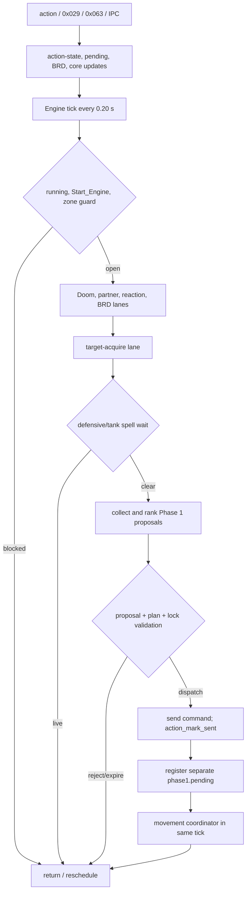
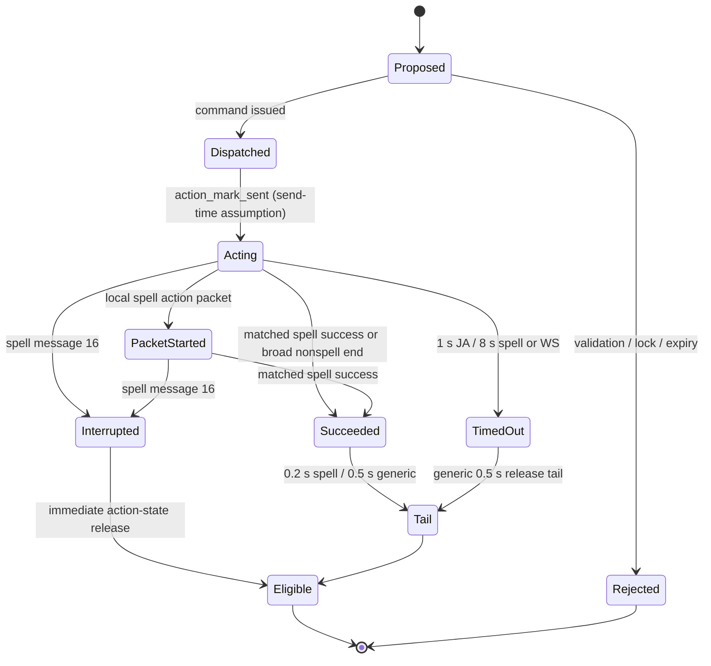
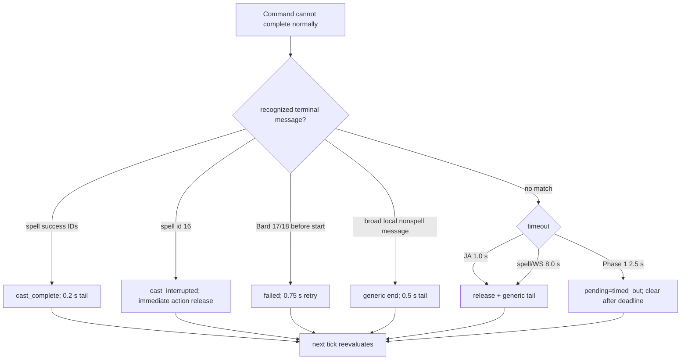

# AE1 — Scheduler action economy audit

Audit date: 2026-07-22
Scope: current working tree, including pre-existing uncommitted changes
Method: static cross-module trace plus the repository's Lua 5.1 replay/selftest suite
Production behavior changed by this audit: no

Evidence labels used below:

- **Confirmed by code**: the stated transition or absence is directly visible in the repository.
- **Strong inference**: the code proves the ingredients, but the final client/runtime consequence requires a live trace.
- **Unconfirmed**: neither code nor existing tests establish the behavior.
- **Requires runtime trace**: packet ordering, game acceptance, animation, or another addon determines the answer.

## 1. Executive summary

UnifiedCombat does not have one authoritative action lifecycle. It has at least four overlapping mechanisms:

1. `uc_scheduler_action_state.lua` serializes spell, weapon-skill (WS), and job-ability (JA) sends through `action_start`, `action_end`, and `cooldown_until`.
2. Phase 1 keeps a separate `phase1.pending` record with short acknowledgement/effect deadlines and a broad callback matcher.
3. Pull, tank-enmity, Bard, engage, skillchain, and defensive-cast paths add their own waits and locks.
4. Movement is distributed across scheduler globals, core state, follow, pathing, formation, and special encounter owners.

The scheduler normally evaluates at 5 Hz. A send immediately marks the action as acting; it does not wait for proof that the game accepted or started it. A matched spell success message releases the action with a 0.2 s tail. A matched interruption releases immediately. JA actions time out after 1.0 s and spell/WS actions after 8.0 s if no callback ends them; generic non-spell completion applies a 0.5 s tail. Phase 1 independently times live pending records out after 2.5 s.

Important conclusions:

- **Confirmed by code:** spell success/interruption has type-specific terminal handling, but generic WS/JA completion is any local non-spell action message, not an action-correlated result (`unified_scheduler.lua:8006-8121`, `uc_scheduler_action_state.lua:316-326`).
- **Confirmed by code:** Phase 1 may acknowledge or complete a pending action from an unrelated local action or broad target/message match; interruption is recorded as Phase 1 `complete`, not `failed` (`unified_scheduler.lua:7802-8121`).
- **Confirmed by code:** ordinary WS eligibility does not consistently enforce range or incapacitating buffs. The stricter Sleep/Stun/Terror/etc. set is used in skillchain commit validation, not all WS dispatches (`unified_combat_core.lua:244-267`, `unified_scheduler.lua:4727-4961`, `unified_scheduler.lua:7280-7380`).
- **Confirmed by code:** ordinary spell/JA readiness checks resources/recasts but not Silence, Paralysis, Stun, Sleep, Terror, Petrification, Charm, or Amnesia (`unified_scheduler.lua:2990-3011`, `unified_scheduler.lua:3259-3323`). Failure recovery is therefore usually a broad message match or timeout.
- **Confirmed by code:** scheduler stop/unload/logout and zone cleanup do not clear all Phase 1, defensive-wait, tank-wait, and action metadata. Some stale state self-expires, but reset ownership is incomplete (`UnifiedCombat.lua:2048-2097`, `unified_engine.lua:399-403`, `uc_scheduler_locks.lua:83-94`).
- **Confirmed by code:** successful/interrupted spells shorten the shared `UC_MOVEMENT_LOCK_UNTIL` without checking `UC_MOVEMENT_OWNER`; a scheduler spell can shorten another subsystem's lock (`unified_scheduler.lua:2255-2258`, `unified_scheduler.lua:2286-2291`).
- **Strong inference:** follow can race an out-of-combat defensive cast because follow does not honor owner `scheduler`, while pathing honors any live foreign owner. Scheduler tick and prerender ordering determines the live outcome (`uc_party_follow.lua:722-800`, `uc_pathing.lua:835-892`, `unified_scheduler.lua:1258-1279`).
- **Confirmed by code:** Doom Holy Water is dispatched outside normal action-state tracking; it uses a fixed 1.2 s retry and has no item-result correlation (`unified_scheduler.lua:109-110`, `unified_scheduler.lua:1748-1831`, `unified_scheduler.lua:7566-7588`).

No static analysis can prove when the FFXI client returns to idle, whether a command was accepted, or the relative arrival order of Windower's high-level action event and raw `0x029` message. Those require the instrumentation in section 16.

## 2. Scheduler architecture overview

`UnifiedCombat.lua` loads `unified_combat_core`, `unified_engine`, follow, and pathing. `unified_engine` schedules a 0.20 s tick and invokes `unified_scheduler.process_tick()`. The scheduler gathers proposals, ranks them, dispatches one, then runs movement coordination. High-level action and raw packet events enter through `UnifiedCombat.lua` and are forwarded into both core and scheduler.

### Scheduler state-transition diagram



Evidence:

- `UnifiedCombat.lua:366-398`: active UC core/engine wiring.
- `unified_engine.lua:9-18`, `unified_engine.lua:316-381`: 5 Hz scheduling and defensive/maintenance cadences.
- `unified_scheduler.lua:7566-7669`, `scheduler.process_tick()`: lane order, proposal dispatch, and movement coordination.
- `UnifiedCombat.lua:1935-2032`: action, incoming chunk/text, IPC, outgoing chunk, and prerender registrations.
- `uc_scheduler_pending_record.lua:3-34`: Phase 1 pending registration happens after dispatch.

The old `melee_engine.lua`, `dd2_module.lua`, and `dd2_engine.lua` contain additional waits and pet/action code, but the active entrypoint forces engine `UC` and does not require those engines. They are dormant compatibility code for this audit, not part of the live scheduler path. **Confirmed by code** (`UnifiedCombat.lua:366-398`; repository-wide require search).

## 3. Unified action lifecycle

The common ranked lifecycle is:

1. A provider emits a proposal with action type, target, priority band, urgency, expiry, commit deadline, duplicate key, and lock class.
2. Phase 1 validates settings/snapshot age, pending locks, expiry, commit feasibility, and duplicate suppression.
3. Rank is primarily priority band, then urgency, then expiry/provider/id tie-breakers.
4. The action-specific dispatcher revalidates a subset of readiness and constructs or sends the command.
5. `action_mark_sent_with_meta()` increments `action_token`, writes metadata, sets `action_start = now`, `action_end = now - 0.001`, and a 0.6 s minimum cooldown. This means **command sent is treated as action started**.
6. Phase 1 creates a second pending record with 0.6/2.5/3.0 s deadlines.
7. Events may advance action state, Phase 1 pending, provider-specific state, or all three independently.
8. The next ranked spell/JA/WS is legal only when action state and Phase 1 locks permit it. Engage has a narrow action-state bypass. Movement has separate ownership tests.



The code does **not** maintain distinct universal states for client acceptance, animation start, damage/effect application, recast start, aftercast, or return-to-idle. Spell packets/messages and Bard status snapshots represent some of these concepts in specific paths. For generic WS/JA they are collapsed into send-time acting plus broad termination.

Evidence:

- `uc_scheduler_action_state.lua:156-228`, `action_mark_sent()` / `action_mark_sent_with_meta()`.
- `uc_scheduler_action_state.lua:269-326`, packet start/end helpers.
- `uc_scheduler_action_state.lua:656-718`, timeout and tail transition.
- `unified_scheduler.lua:5539-5687`, proposal validation/ranking.
- `uc_scheduler_dispatch_plan.lua`, plan creation/revalidation.
- `uc_scheduler_pending_record.lua:11-33`, separate pending deadlines.

## 4. Scheduler next-action eligibility

### Ordered live decision path

1. **Engine gate.** `engine.running`, global `Start_Engine`, a usable time source, and the 15 s zone guard must permit the tick. A re-entrancy `processing` guard prevents overlapping engine ticks. Disabled/stop returns without dispatch. **Confirmed by code** (`unified_engine.lua:316-381`; `UnifiedCombat.lua:51-53`, `2048-2059`).
2. **Emergency and reserved lanes.** Doom, partner arbitration, reaction, and Bard maintenance run before general proposals. A live Bard song/JA sequence reserves the lane and can block every non-Bard proposal. **Confirmed by code** (`unified_scheduler.lua:7566-7618`; `uc_brd_maintenance.lua:1851-2045`).
3. **Target acquisition.** Target selection is nonblocking but debounced 0.20 s. It may consume the tick when it sends. **Confirmed by code** (`unified_scheduler.lua:1956`, `unified_scheduler.lua:3970-4105`, `unified_scheduler.lua:7589-7598`).
4. **Spell wait gates.** Defensive and tank spell waits are global scheduler blockers until action state is neither acting nor cooling down, or until 8 s. **Confirmed by code** (`unified_scheduler.lua:770-855`, `7603-7608`).
5. **Proposal collection cadence.** General combat collectors run at 5 Hz, defensive proposals at 2 Hz, and non-Bard maintenance at 1 Hz. **Confirmed by code** (`unified_engine.lua:355-369`; `unified_scheduler.lua:4014-5260`).
6. **Snapshot/settings gate.** Proposal validation checks enablement, recent snapshot, expiry/commit deadline, target/provider metadata, pending lock class, and duplicate key. Stale or invalid proposals are rejected for that tick; providers may propose again later. **Confirmed by code** (`unified_scheduler.lua:5539-5612`).
7. **Phase 1 pending locks.** A live pending record hard-locks spell/JA/WS and move proposals. It does not hard-lock engage, target, pull, or item action types. **Confirmed by code** (`uc_scheduler_locks.lua:28-62`).
8. **Action state.** `action_dispatch_blocked()` rejects while acting or before `cooldown_until`. JA timeout is 1.0 s; spell/WS timeout is 8.0 s. A Majesty-to-defensive-Cure weave and explicit `attack_on` have narrow exceptions. **Confirmed by code** (`uc_scheduler_action_state.lua:613-654`, `720-887`).
9. **Action-specific readiness.** Spells check resource existence/known/job access/recast/MP. JAs check ownership, recast, status 3, and several ability-specific requirements. WS checks engaged status, TP, and target at scheduler dispatch; range is not uniformly rechecked. **Confirmed by code** (`unified_scheduler.lua:2990-3011`, `3259-3323`, `4727-4961`, `7280-7380`).
10. **Target geometry.** Sleep and some tank/pull target-id paths enforce range. Generic current-target combat spell and ordinary WS paths do not uniformly enforce range/line of sight at commit. Facing proposals are independent and turning has no completion lock. **Confirmed by code** (`unified_scheduler.lua:6930-7250`; `uc_scheduler_dispatch_plan.lua`).
11. **Dispatch and state registration.** The command is sent, action state is marked, and Phase 1 pending is recorded. Failed pre-send validation drops the current proposal; normal polling can regenerate it. **Confirmed by code** (`unified_scheduler.lua:6400-7475`; `uc_scheduler_pending_record.lua`).
12. **Movement coordination.** It runs after general dispatch in the same tick. A just-sent spell is held by action state, but JA/WS do not receive an equivalent movement freeze. **Confirmed by code** (`unified_scheduler.lua:7619-7669`, `2401-2646`).

### What is and is not gated

| Gate | Current behavior | Evidence label |
|---|---|---|
| Scheduler stop/pause | Stops ticks; does not comprehensively clear pending/action/wait state | Confirmed by code |
| Dead status | Core and JA paths block `status == 3`; legacy defensive permits only statuses 0/1/5/85 | Confirmed by code |
| Sleep/Stun/Terror/Petrification/Charm/Amnesia | Explicitly checked for skillchain WS commit only; not a universal action gate | Confirmed by code |
| Silence | No ordinary spell pre-send gate found | Confirmed absence by repository search |
| Paralysis | No ordinary spell/JA/WS pre-send gate or dedicated failure transition found | Confirmed absence by repository search |
| Menu/cutscene/user-control | No explicit scheduler gate found | Confirmed absence by repository search |
| Casting animation | Player `status == 4` holds movement; action serialization uses timestamps/events, not animation-idle proof | Confirmed by code |
| Recasts/resources | Polled before proposal/dispatch for most spell/JA/WS paths | Confirmed by code |
| Line of sight | No generic LOS preflight exists | Confirmed absence by repository search |
| Follow/navigation owner | Movement-only arbitration; not a universal action eligibility gate | Confirmed by code |
| Profile/runtime override reload | Changes later proposal/config reads; no atomic cancellation of an existing pending action | Confirmed by code |

Outcomes are implemented as follows:

- **Issue now:** highest valid proposal passes Phase 1 and action-specific dispatch.
- **Delay/reevaluate:** action/cooldown/pending/settle/BRD/wait gate returns; next engine tick polls again.
- **Reject permanently:** only the current proposal object is rejected; configuration/resource absence may cause the provider not to emit another.
- **Retry same action:** providers normally regenerate proposals; engage, BRD, pull/tank, and failure throttles have explicit retry windows.
- **Clear and continue:** terminal callbacks clear action state or pending; the next 0.20 s tick re-ranks all intents.
- **Stop/reset:** stop halts ticks; zone adds a 15 s guard and resets selected subsystems, but no single full scheduler-state reset exists.

## 5. Spell lifecycle and completion paths

### Successful spell timeline

```mermaid
sequenceDiagram
    participant Tick as Scheduler tick
    participant Move as Movement coordinator
    participant Game as FFXI/Windower
    participant AS as Action state
    participant P1 as Phase 1 pending
    Tick->>Move: stop + 0.75 s precast settle (combat spell path)
    Tick->>Game: send spell command
    Tick->>AS: token++; start=send time; cooldown >= +0.6
    Tick->>P1: sent; effect deadline +2.5
    Game-->>AS: optional local spell-start action packet
    Game-->>AS: local 0x029 message 2/230/236/252
    AS->>AS: terminal=cast_complete; end=now; cooldown=now+0.2
    AS->>Move: shorten shared lock to at most now+0.2
    AS->>P1: mark complete; retain duplicate tail 0.75
    Note over Tick: next eligible tick after action tail and pending lock release semantics
```

Spell intent comes from combat, defensive, tank, Sleep, reaction, or Bard providers. Dispatch calls `action_ready()` again, constructs a command, may stop movement, sends it, then calls `action_mark_sent_with_meta()`. Start detection accepts high-level local spell action categories and only annotates an already-current spell token; send time remains the initial acting boundary (`unified_scheduler.lua:7802-8004`, `uc_scheduler_action_state.lua:292-314`).

Success IDs encoded by the generic scheduler are `2`, `230`, `236`, and `252`; start IDs are `3` and `229`; interruption is `16`; Bard prestart rejection recognizes `17` and `18` (`unified_scheduler.lua:396-413`). The message must be local and match the active spell name when both names are present; it does not match target ID or a packet-carried correlation token (`unified_scheduler.lua:416-455`, `2204-2297`).

On success, action state records `cast_complete`, ends acting, and leaves a 0.2 s tail. Defensive/tank wait state is cleared. Phase 1 is marked complete and persists for a 0.75 s duplicate-suppression/cleanup tail. **Confirmed by code** (`uc_scheduler_action_state.lua:452-573`; `unified_scheduler.lua:2234-2265`; `uc_scheduler_pending.lua:38-52`).

### Interrupted spell timeline

```mermaid
sequenceDiagram
    participant Game as FFXI/Windower
    participant S as Scheduler
    participant AS as Action state
    participant M as Movement
    participant P1 as Phase 1 pending
    Game-->>S: local spell message 16
    S->>AS: match active spell token/name
    AS->>AS: terminal=cast_interrupted; end=now; cooldown=now
    S->>M: shorten UC_MOVEMENT_LOCK_UNTIL to at most now+0.2
    S->>P1: mark complete (not failed)
    S->>S: clear defensive/tank waits; cancel BRD pending if applicable
    Note over S: another action may be selected on the next 0.20 s tick
```

Movement-, damage-, stun-, sleep-, terror-, or knockback-caused interruptions are not distinguished. If the game emits message `16` and the active spell matcher accepts it, all share this immediate terminal path. If it does not, recovery is the 8 s timeout. **Confirmed by code for message handling; requires runtime trace for cause-to-message mapping.**

### Pre-send and abnormal spell outcomes

| Condition | What the current code does |
|---|---|
| Insufficient MP / spell recast unavailable | `spell_ready()` rejects before send; provider may propose later. |
| Silence / Paralysis | No dedicated pre-send gate or generic terminal classification; broad message handling or 8 s timeout. |
| Stun/Sleep/Terror/Petrification/Charm | No universal spell gate; command may be attempted; message 16 clears only if emitted/matched. |
| Invalid/lost/dead target | Some proposal/commit paths reject. Generic ally/current-target paths do not uniformly revalidate hpp/range/LOS immediately before send. No universal target-death cancellation. |
| Out of range / LOS | Sleep/tank/pull have explicit geometry checks; ordinary current-target spells lack a universal check. Failure messages other than the classified IDs may leave action state until timeout. |
| Local cancel / command rejection | Only generic interruption `16`, classified success, and Bard-only prestart `17/18` have explicit terminal behavior. |
| Death, zone, unload, addon stop | No universal immediate spell action-state cleanup. Zone pauses 15 s; normal action timeout is 8 s when ticks resume. Unload/logout stop ticks. |
| Missing callback | Action state releases after 8 s; Phase 1 times out after 2.5 s. These independent clocks can disagree. |
| Duplicate `0x029` | Scheduler dedupes identical non-raw signature within 0.25 s. Raw handling occurs first in the current entrypoint, then the extra parsed forward is normally suppressed. |
| Out-of-order/late callback | Active-token terminal rules reject already-terminal tokens. A later new action with the same spell name cannot be packet-token correlated; runtime trace is required to quantify misattribution. |

No GearSwap event is used. Incoming text is a lifecycle probe/logging input, not authoritative completion (`UnifiedCombat.lua:1994-2000`; `unified_scheduler.lua:458-767`). Recast start and animation idle are not used to complete spells.

### Bard songs

Bard maintenance has an additional state machine: `awaiting_start` (2 s), `casting` (20 s), and `awaiting_snapshot` (2 s). It uses exact spell identity, action start/finish, success message IDs `205/230/266/280`, recipients, and status snapshot `0x063`. A live sequence reserves the action lane. Targeted song/JA sequences also use confirmation retries and safety windows. This is more specific than generic spell handling, but the generic action state and Phase 1 pending still coexist (`uc_brd_maintenance.lua:7-20`, `849-1168`, `1851-2045`).

## 6. Weapon-skill lifecycle and completion paths

### Weapon-skill timeline

```mermaid
sequenceDiagram
    participant C as WS collector / skillchain state
    participant S as Scheduler dispatch
    participant G as FFXI/Windower
    participant A as Action state
    participant P as Phase 1 pending
    C->>C: engaged + TP >= 1000 + target + plan
    C->>S: ranked WS proposal
    S->>S: recheck status/TP/current target; skillchain may add timing gates
    S->>G: send /ws command
    S->>A: acting at send time; 0.6 s cooldown
    S->>P: pending with 2.5 s effect deadline
    G-->>S: any local non-spell action message
    S->>A: generic packet end
    S->>P: complete if broad actor/target match
    A->>A: 0.5 s generic tail, or 8 s timeout if no end
```

Preconditions include scheduler enablement, player engaged status, TP at least 1000, current target/actionability, core WS selection, and proposal/commit timing. Skillchain WS additionally consults incapacitating buffs, party intent, earliest/latest close windows, and target continuity. Ordinary WS does not consistently use that stricter buff gate or a final range check. **Confirmed by code** (`unified_scheduler.lua:4727-4961`, `7280-7380`; `unified_combat_core.lua:244-267`, `2920-3160`).

After dispatch, WS shares generic action state. Numeric WS action packets do not establish a distinct correlated start in `note_local_spell_packet_start()` because that helper accepts only `last_send_kind == 'spell'`. Completion is any local non-spell action message that calls `action_mark_packet_end()`. Damage/result success is not required and failure/no-effect is not classified. Phase 1 separately completes on broad actor/target/message criteria. **Confirmed by code** (`unified_scheduler.lua:7802-8121`; `uc_scheduler_action_state.lua:292-326`).

Target death, TP loss, range failure, incapacitation, or client rejection after collection may therefore produce either a broad early completion or the 8 s timeout, depending on which message arrives. No animation-idle signal is required. Movement is not explicitly stopped for ordinary WS; movement coordination may continue in the same tick.

Skillchain timing adds deliberate waits: 3.0 s ordinary minimum delay, 0.3 s dispatch buffer, 0.6 s latest-window guard, 2.0 s Chainbound delay, a 0.12 s local intent commit delay, 0.9 s remote hold, 1.0 s loser cooldown, and 1.6 s party WS hold (`uc_skillchain_state.lua:3-13`; `unified_combat_core.lua:205-214`). These gate WS selection, not generic result completion.

## 7. Job-ability lifecycle and completion paths

### Job-ability timeline

```mermaid
sequenceDiagram
    participant P as JA provider
    participant S as Scheduler
    participant G as FFXI/Windower
    participant A as Action state
    P->>S: ready JA proposal
    S->>S: owner/recast/status/special-condition checks
    S->>G: send /ja command
    S->>A: acting at send time; cooldown >= 0.6 s
    G-->>S: any local non-spell action message
    S->>A: packet end; generic 0.5 s tail
    alt no matching callback
        A->>A: release after 1.0 s JA timeout + generic tail
    end
```

JA readiness checks resource ownership, recast, death status, target/actionability for enemy abilities, and special cases such as Chivalry. It does not universally check Amnesia, Paralysis, Stun, Sleep, Terror, Petrification, or Charm (`unified_scheduler.lua:3259-3323`). All ordinary JAs share the generic non-spell completion path; there is no no-effect, paralysis, invalid-target, or animation-length-specific terminal strategy.

Special cases:

- **Majesty -> Cure:** action-state policy allows a bounded defensive Cure weave instead of making the JA tail block the urgent spell (`uc_scheduler_action_state.lua:201-228`, `720-887`).
- **Pianissimo and Bard JAs:** Bard state waits for buff/status confirmation and retries confirmation at 0.5 s; a confirmed Pianissimo can end action state while the song sequence continues (`uc_brd_maintenance.lua:849-1168`, `1851-2045`; `unified_scheduler.lua:7802-8004`).
- **Chivalry:** core adds a 1.25 s hold after a 0.5 s JA lock (`unified_combat_core.lua:3210-3230`).
- **Pull/tank JAs:** core adds 0.5 s JA locks and pull-specific 0.6 s ownership holds (`unified_combat_core.lua:2038-2047`, `2217-2232`).
- **Skillchain-opening abilities:** `Wild Flourish` action id 209 and `Konzen-ittai` 320 create 3 s and 60 s source windows; actual WS selection also uses skillchain timing (`uc_skillchain_state.lua:10-13`, `183-380`).

Instant abilities and long-animation abilities are not differentiated by generic action state. The next action can be legal after the broad callback plus 0.5 s tail, or after the 1.0 s timeout when no callback matches. Whether that is earlier or later than the game animation is **requires runtime trace**.

## 8. Other action types

| Type | Scheduler support and lifecycle |
|---|---|
| Engage / attack-on | Explicit scheduler action. Send uses a 0.35 s action-state tail plus a separate 1.75 s pending-engage state, 0.40 s rejection retry, and 0.30 s duplicate retry debounce. Actual engaged status confirms; message 94 means wait longer. |
| Target selection | Nonblocking proposal/side effect with 0.20 s debounce. It has no result-correlated action state. |
| Facing / turn | Proposal or movement-side operation. No action completion state; next tick may turn again. |
| Movement / formation | Coordinated every tick and owned through globals/run calls, not action-state completion. |
| Follow | Runs on prerender and IPC state. It has its own 0.05 s broadcast interval and 0.4 s activity/catch-up holds. |
| Navigation/pathing | Runs from prerender; honors live foreign movement ownership and pull flags. |
| Item use | Doom Holy Water only in the active scheduler audit. It stops movement and sends item every 1.2 s while Doom persists, but does not call `action_mark_sent`; no item success/failure packet correlation exists. |
| Ranged attack | Action parser recognizes a ranged category, but no active scheduler proposal/dispatch lifecycle was found. Unsupported by the current scheduler. |
| Pet command/action | No active UC scheduler proposal/dispatch lifecycle. Pet code exists in dormant DD2/melee engines. |
| Trust/summon | No active scheduler-specific lifecycle found. A configured spell could traverse generic spell handling, but no Trust-specific selection/completion logic exists. |
| Generic command | Dispatcher supports command/run/run-stop/turn/target intents. Completion depends on the calling provider; there is no universal command acknowledgement. |

Evidence:

- Engage: `unified_scheduler.lua:869-1135`, `6810-6925`; `uc_scheduler_action_state.lua:184-199`, `613-654`.
- Doom item: `unified_scheduler.lua:109-110`, `1748-1831`, `7566-7588`.
- Movement/facing: `unified_scheduler.lua:2401-2646`, `4014-4505`.
- Follow/path: `uc_party_follow.lua:25-36`, `722-984`; `uc_pathing.lua:835-892`.
- Category parsing without ranged collector: `unified_scheduler.lua:7802-8004`; repository-wide proposal/command search.

## 9. Abnormal termination and recovery

### Failure/timeout recovery diagram



| Abnormal condition | Detection/recovery | Assessment |
|---|---|---|
| Sleep, Stun, Terror, Petrification, Charm | Explicit only in skillchain WS commit buff set; generic actions depend on messages/timeouts | Confirmed by code; runtime message mapping unconfirmed |
| Paralysis | No dedicated gate or terminal path | Confirmed gap; likely 1 s JA or 8 s spell/WS recovery |
| Silence | No dedicated spell gate or terminal path | Confirmed gap; failure callback behavior requires trace |
| Amnesia | Skillchain WS set includes it; generic JA does not | Confirmed inconsistency |
| Doom | Holy Water emergency retries at 1.2 s; no result tracking | Confirmed by code |
| Death/status 3 | Prevents many new actions; does not globally clear an already-current action/pending record | Confirmed stale-state risk |
| Knockback/forced/manual movement | No explicit cause detector; spell message 16 clears if delivered/matched | Requires runtime trace |
| Target death/despawn/invalid | Rechecked in selected paths; stale combat-spell target transition can clear old spell state; no universal pending cancellation | Confirmed distributed behavior |
| Range/LOS failure | Geometry checks are path-specific; generic failure classification incomplete | Confirmed gap |
| Resource/recast failure | Mostly prevented by polling; race after collection can still reach client; no universal failure result | Confirmed by code |
| Command rejection | Bard 17/18 and engage 94 are explicit; other message IDs are not generically terminal for spells | Confirmed by code |
| Zone | Resets selected trackers and pauses 15 s, but not full action/pending/wait state | Confirmed stale-state risk |
| Unload/logout | Stops engine and resets selected providers; full scheduler state not reset | Confirmed stale-state risk if module state survives stop/restart |
| Scheduler disable/stop | Ticks cease; active state is retained until restart/other events/timeout | Confirmed by code |
| Profile/runtime override reload | Later reads change; current pending/action record is not atomically canceled | Confirmed by code |
| Manual/other-addon action | Broad local actor/message callbacks can acknowledge/end the scheduler's current action | Confirmed correlation defect |
| Missing callback | Phase 1 2.5 s and action state 1/8 s timeouts independently recover | Confirmed by code |
| Duplicate callback | 0x029 signature dedupe window 0.25 s; provider/action handlers may still receive multiple distinct callbacks | Confirmed by code |
| Out-of-order callback | No game-issued correlation id; active spell name/token heuristics can reject or misattribute late events | Strong inference |

Core pull/tank spell handling differs: it recognizes initiating IDs `3/43/326/327/675/716`, success IDs `2/236/237/252/268/271`, and treats other matching nonzero messages as failure/retry (`unified_combat_core.lua:190-203`, `2840-3060`). Thus the same message can advance core and scheduler differently.

## 10. Movement restriction and restoration

Movement ownership is not centralized. `UC_MOVEMENT_OWNER`, `UC_MOVEMENT_LOCK_UNTIL`, `UC_MOVE_FREEZE_PREP_*`, pull globals, action state, player status, and provider-local waits all participate.

### Movement ownership timeline

```mermaid
sequenceDiagram
    participant A as Action provider
    participant S as Scheduler/core
    participant O as UC_MOVEMENT_OWNER/LOCK
    participant F as Follow
    participant P as Pathing
    A->>S: spell selected
    S->>O: run_stop; owner=scheduler; short sliding lock
    S->>S: action state acting / provider wait
    F->>O: prerender arbitration (does not recognize owner scheduler)
    P->>O: prerender arbitration (honors any live foreign owner)
    S->>O: success/interruption shortens lock, or timeout expires
    O-->>F: follow may reacquire if its suppression tests allow
    O-->>P: pathing may reacquire after owner/lock clears or expires
    Note over O: no universal explicit resume command; owners repoll and issue run
```

### Major action timelines

**Ordinary combat spell**

`selected -> set prep key/until +0.75 -> run_stop -> reevaluate during settle -> clear prep -> send -> action-state spell freeze -> success +0.2 tail / interruption immediate / timeout 8 s -> movement coordinator permits core/formation -> follow/path may reacquire.`

Evidence: `unified_scheduler.lua:7087-7250`, `2401-2646`; `uc_scheduler_action_state.lua:452-573`, `656-718`.

**Defensive or tank spell**

`selected -> run_stop -> owner=scheduler + lock 0.6 -> begin 8 s wait -> send -> each tick refreshes lock to min(wait end, now+0.6) -> matched success/interruption clears wait and shortens lock to now+0.2 -> owners repoll; otherwise wait/action timeout releases.`

Evidence: `unified_scheduler.lua:770-855`, `1258-1279`, `3744-3907`, `6635-6690`.

**Bard song**

`BRD lane reserved -> generic defensive spell movement lock if routed through that branch -> send -> Bard awaiting_start/casting/awaiting_snapshot -> generic spell terminal may release action/movement before Bard snapshot finishes -> Bard lane remains reserved until sequence confirmation/timeout.`

Evidence: `uc_brd_maintenance.lua:849-1168`, `1851-2045`; `unified_scheduler.lua:7600-7618`.

**WS**

`selected -> command sent -> no explicit run_stop/freeze -> action state blocks later spell/JA/WS but movement coordinator can run -> broad completion or 8 s timeout -> generic 0.5 s action tail.`

**JA**

`selected -> command sent -> normally no explicit run_stop -> broad completion or 1 s timeout -> 0.5 s tail; pull/tank/Chivalry special cases add 0.5-1.25 s locks.`

**Doom item**

`Doom detected -> run_stop immediately (even before item cooldown test) -> Holy Water command -> no action state -> movement may be reconsidered next tick -> repeat after 1.2 s while Doom remains.`

### Answers to movement questions

- Spells are the only generic action class with explicit pre-send stopping. WS/JA/item movement treatment is path-specific.
- Restoration is usually expiration/re-polling, not an explicit resume paired with the stop.
- Success and interruption shorten spell locks; timeout ends action/provider waits. Unclassified failures wait for timeout.
- Follow/navigation can reacquire immediately after their own gates allow it; there is no universal post-action movement owner handoff.
- The 0.2 s spell-success tail deliberately delays both next action and movement coordinator spell-freeze release.
- Bard's provider lane may remain blocked after generic spell movement/action state releases, pending status confirmation.
- Incapacitating statuses do not acquire a universal movement lock. Actual client inability to move is external to scheduler state.

**Confirmed ownership defect:** `handle_local_spell_action_message()` uses `math.min(current_lock_until, now + 0.2)` without checking owner. If another subsystem currently owns a longer or infinite lock, the scheduler shortens it. The existing tests assert the shortening expression but do not exercise cross-owner collision (`unified_scheduler.lua:2255-2258`, `2286-2291`; `tests/replay/harness/selftest_scheduler_spell_success_action_state.lua`; `tests/replay/harness/selftest_scheduler_spell_interruption_action_state.lua`).

## 11. Hard-coded and calculated timing inventory

This inventory covers active-path values that can affect action selection, serialization, movement, retry, or state cleanup. Repository-wide searches also found timing code in dormant DD2/melee engines, TargetBar, diagnostics, sockets, and tests. Those values do not participate in the active `UnifiedCombat -> unified_engine -> unified_scheduler` execution path and are not mixed into this table. No active-path console command containing a command-line `wait` was found.

| Timing name/value | Location | Trigger | Blocks / release | Action types | Primary or fallback | Notes |
|---|---|---|---|---|---|---|
| Engine tick `0.20 s` | `unified_engine.lua:9-18`, `316-381` | Engine start / prior tick | All polling until next tick | All | Primary cadence | Adds 0-200 ms quantization to eligibility. |
| Defensive cadence `0.50 s` | `unified_engine.lua:355-365` | Defensive collection | New defensive candidate | Cure/buff | Primary cadence | Worst-case 500 ms before proposal. |
| Maintenance cadence `1.00 s` | `unified_engine.lua:361-369` | Maintenance collection | New non-BRD maintenance candidate | Maintenance | Primary cadence | Bard has a faster reserved lane. |
| Zone guard `15 s` | `UnifiedCombat.lua:51-53`, `2048-2059` | Zone event | Non-move scheduler work / engine tick | All | Primary safety guard | Does not itself clear all action state. |
| Send sentinel `0.001 s` | `uc_scheduler_action_state.lua:156-182` | Any tracked send | Makes `end < start` immediately | Spell/JA/WS | State encoding | Not a real client delay. |
| Initial action cooldown `0.60 s` | same | Tracked send | Later tracked actions | Spell/JA/WS | Primary minimum spacing until terminal override | Success/interruption can shorten it. |
| Spell success tail `0.20 s` | `uc_scheduler_action_state.lua:2-3`, `452-573` | Matched success | Next tracked action and spell movement freeze | Spell | Primary post-completion tail | Authoritative event releases earlier than initial 0.6. |
| Spell interruption tail `0 s` | `uc_scheduler_action_state.lua:328-418` | Message 16 | No action-state tail | Spell | Primary terminal path | Movement global may remain up to 0.2 s. |
| Generic end tail `0.50 s` | `uc_scheduler_action_state.lua:656-718` | Acting -> ended transition | Next tracked action | JA/WS/generic | Primary post-end tail | Applied after broad callback or timeout transition. |
| Spell/WS missing-event timeout `8.0 s` | `unified_scheduler.lua:87`; `uc_scheduler_action_state.lua:656-718` | Send with no terminal match | Tracked actions | Spell/WS | Fallback | Does not wait for animation idle. |
| JA missing-event timeout `1.0 s` | `unified_scheduler.lua:88`; same helper | JA send with no terminal match | Tracked actions | JA | Fallback | Long-animation JA may release before animation ends. |
| Defensive Cure weave `5.0 s` | `uc_scheduler_action_state.lua:201-228` | Qualifying preceding JA | Alters action-state gate | JA -> Cure | Policy window | Exception to ordinary serialization. |
| Engage action tail `0.35 s` | `uc_scheduler_action_state.lua:2`, `184-199` | Explicit attack-on sent | Repeat engage | Engage | Primary debounce | Does not mark acting. |
| Pending engage `1.75 s` | `unified_scheduler.lua:113`, `869-1135` | Attack-on attempt | Noncritical work; confirmation wait | Engage | Fallback bound | Refreshed on retry. |
| Engage retry `0.40 s` | `unified_scheduler.lua:114`, `869-1135` | Message 94 | Next attack-on attempt | Engage | Explicit retry | Game-side “wait longer.” |
| Engage duplicate debounce `0.30 s` | `unified_scheduler.lua:116`, engage helpers | Attack-on send | Duplicate engage send | Engage | Safety margin | Separate from action tail and pending state. |
| Target acquire debounce `0.20 s` | `unified_scheduler.lua:1956`, `3970-4105` | Target selection | Same duplicate target intent | Target | Safety margin | Nonblocking lane. |
| Proposal TTL `0.30-0.40 s` | `unified_scheduler.lua:4014-5260` | Proposal creation | Expired proposal cannot dispatch | All ranked | Primary freshness | Many TTLs span only 1-2 engine ticks. |
| Proposal commit deadline `0.20-0.25 s` | same | Proposal creation | Late dispatch | All ranked | Primary freshness | Can expire at the next 0.20 s tick boundary. |
| Pending ack `0.60 s` | `uc_scheduler_pending_record.lua:23` | Post-dispatch record | Metadata only in current updater | Ranked actions | Nominal | No generic state transition uses `ack_deadline`. |
| Pending effect `2.50 s` | `uc_scheduler_pending_record.lua:24`; `uc_scheduler_pending.lua:3-25` | Post-dispatch record | Phase 1 spell/JA/WS/move locks | Ranked actions | Fallback | Converts live pending to `timed_out`. |
| Pending completion `3.00 s` | `uc_scheduler_pending_record.lua:25` | Post-dispatch record | Retains timed-out/failed record | Ranked actions | Cleanup bound | Effect timeout at 2.5 leaves about 0.5 s before cleanup. |
| Pending/duplicate completion tail `0.75 s` | `uc_scheduler_pending.lua:38-68`; pending record | Completion/failure/timeout | Duplicate key; record retention | Ranked actions | Safety margin | May outlive shorter action-state tails. |
| `0x029` duplicate window `0.25 s` | `unified_scheduler.lua:8006-8035` | Identical action message signature | Duplicate handler pass | All messages | Safety margin | Ordering-sensitive raw/non-raw dedupe. |
| Spell lifecycle recent window `12 s` | `unified_scheduler.lua:462-468` | Probe/logging | Diagnostic correlation only | Spell | Diagnostic | Does not gate action economy. Included to distinguish it from control state. |
| Defensive/tank spell wait `8.0 s` | `unified_scheduler.lua:770-855` | Spell dispatch | Entire scheduler tick and movement | Defensive/tank spell | Fallback bound | Event/action-state release can end early. |
| Sliding movement lock `0.60 s` | `unified_scheduler.lua:770-855`, `1258-1279` | Defensive/tank cast/wait refresh | Pathing and scheduler movement | Spell | Primary short lease | Refreshed each scheduler tick. |
| Success/interruption movement tail `0.20 s` | `unified_scheduler.lua:2255-2291` | Spell terminal | Shared movement lock | Spell | Primary tail | Missing owner check. |
| Combat spell precast settle `0.75 s` | `unified_scheduler.lua:7087-7185` | Combat spell selected while moving | Spell send; stops movement | Combat spell | Primary settle | Re-evaluated at 5 Hz. |
| Tank action settle `0.25 s` | `unified_scheduler.lua:6824-6883` | Tank action selected | Tank action send | Tank JA/spell | Primary settle | Run-stop before dispatch. |
| Tank spell extra settle `0.75 s` | `unified_scheduler.lua:7196-7250` | Tank spell selected | Spell send | Tank spell | Primary settle | Can stack with tick quantization. |
| Movement coordinator lease `0.40 s` | `unified_scheduler.lua:2626-2646` | Formation/core movement result | Other movement owners depending on arbitration | Movement | Primary lease | Refreshed every scheduler tick. |
| Doom item reuse `1.20 s` | `unified_scheduler.lua:109-110`, `1748-1831` | Holy Water send | Same item resend | Item | Primary fixed retry | Buff loss, not item result, ends loop. |
| Sleep target suppression `45 s` | `unified_scheduler.lua:1847`, `3110-3150` | Sleep attempt/target state | Same Sleep target proposal | Sleep spell | Safety/fallback | Effect packets can update target state earlier. |
| Dispel attempt cooldown `3.0 s` | `unified_scheduler.lua:184`, reaction/maintenance collectors | Dispel send | Duplicate dispel | Spell/JA maintenance | Retry throttle | Prevents repeated effect removal attempts. |
| Core target set sleeps `0.05/0.10 s` | `unified_combat_core.lua:2127`, `2251-2260` | Pull/target switch | Coroutine and subsequent action | Pull/engage | Primary sequencing | Smallest active action-economy sleeps found. |
| Pull approach/intents `0.50/0.80/2.50 s` | `unified_combat_core.lua:2158-2232` | Range approach or action send | Movement/intent arbitration | Pull | Safety leases | Multiple globals overlap and refresh. |
| Pull spell halt/settle `0.40 s`, freeze `0.45 s` | `unified_combat_core.lua:2177-2193` | Pull spell ready | Send/movement | Pull spell | Primary settle | Explicit run stop. |
| Pull lock `0.90 s` spell / `0.60 s` JA | `unified_combat_core.lua:2208-2222` | Pull action sent | Other pull action | Pull | Safety margin | JA also receives generic 0.5 s JA lock. |
| Pull cast hold `1.0 s`, wait `8.0 s` | `unified_combat_core.lua:2211-2215` | Pull spell sent | Movement and pull pipeline | Pull spell | Primary + fallback | Completion/failure message can clear early. |
| Core JA lock `0.50 s` | `unified_combat_core.lua:2038`, `2219`, `2860`, `3145`, `3223` | Core JA send | Core action paths | JA | Primary safety margin | Separate from scheduler action state. |
| Chivalry hold `1.25 s` | `unified_combat_core.lua:3223-3227` | Chivalry sent | Follow-up action in core | JA | Primary special case | Longer than generic JA timeout. |
| Sticky target hold `1.20 s` | `unified_combat_core.lua:3510-3525` | Target selection/change | Retargeting | Target | Safety margin | Separate from scheduler target debounce. |
| Fight-follow hold configurable `0-60 s`, default `8 s` | `unified_combat_core.lua:269-276` | Combat target/follow state | Follow movement behavior | Movement | Configured/calculated | Clamped. |
| Follow IPC interval `0.05 s` | `uc_party_follow.lua:25-36` | Prerender broadcast | Next position broadcast | Follow | Primary cadence | Network/update timing, not action completion. |
| Follow run/catch-up leases `0.40 s` | same; `uc_party_follow.lua:230-265` | Follow movement/catch-up | Defensive out-of-combat spell proposal | Follow/spell | Safety lease | Explicit defensive deferral reads these globals. |
| Follow randomized initial sleep `0.2-2.7 s` | `uc_party_follow.lua:350-410` | IPC/startup helper | Follow setup/broadcast | Follow | Startup staggering | Not an action terminal timer. |
| BRD start/cast/confirm `2/20/2 s` | `uc_brd_maintenance.lua:7-14`, `1897-1925` | Song dispatch/start/success | Entire BRD lane, therefore all non-BRD proposals | Song/all | Fallback bounds | Events can advance early. |
| BRD JA confirm retry `0.50 s` | same; `uc_brd_maintenance.lua:1950-2045` | Missing JA confirmation | Next confirmation/proposal | Bard JA | Explicit retry | Lane remains reserved. |
| BRD failure retry `0.75 s` | `uc_brd_maintenance.lua:1919-1925`; scheduler prestart branch | Start/cast failure | Same maintenance action | Song | Retry throttle | Phase pending also records failure tail. |
| BRD targeted Troubadour safety `8 s` | `uc_brd_maintenance.lua:11`, sequence logic | Targeted sequence | Song sequencing | Bard | Safety window | Provider-specific. |
| BRD refresh lead `8 + 4/song s` | `uc_brd_maintenance.lua:12-13` | Remaining song timer | Early refresh proposal | Bard song | Calculated policy | Can intentionally serialize refreshes before expiry. |
| BRD timer tolerance `60 s` | `uc_brd_maintenance.lua:14`, timer matching | Snapshot reconciliation | Identity matching, indirectly retry/lane | Bard song | Heuristic | Not a direct sleep. |
| WS intent commit `0.12 s` | `unified_combat_core.lua:205-214` | Local intent broadcast | WS selection | WS | Primary arbitration | Small deliberate coordination delay. |
| WS remote hold `0.90 s`, loser cooldown `1.0 s`, party hold `1.6 s` | same | Party WS intent/result | Local WS | WS | Arbitration/safety | Can stack with skillchain windows. |
| Skillchain min/buffer/late guard `3.0/0.3/0.6 s` | `uc_skillchain_state.lua:3-7` | Skillchain opener/result | Closing WS | WS | Calculated policy | Earliest/latest window based. |
| Chainbound delay `2.0 s`; source windows `3/60 s` | `uc_skillchain_state.lua:6`, `10-13` | Chainbound JA/action ID | Closing WS opportunity | JA/WS | Calculated policy | Action IDs 209 and 320. |
| Magic-burst / Diamond Aspis `10 s` | `uc_skillchain_state.lua:7-8` | Chain result | Burst/encounter policy | Spell | Calculated window | Does not itself prove spell completion. |

Timing stacking examples:

- A combat spell can wait up to one 0.20 s tick, then 0.75 s precast settle, then remain action-locked until a terminal event or 8 s timeout, followed by a 0.2/0.5 s tail and possibly a 0.75 s Phase 1 duplicate tail.
- A Bard song may have scheduler settle/action state plus the provider's 2/20/2 s sequence bounds; the BRD lane, rather than action state, can be the longest blocker.
- A skillchain WS may stack party intent arbitration, the calculated close window, tick quantization, action-state completion, and Phase 1 pending.
- A pull spell has core movement leases/waits in parallel with scheduler action state and movement coordination; the timers are not one additive linear sleep, because callbacks can release some state early.

## 12. Event and packet dependency inventory

| Signal | Registration / parser | Filter and state changed | Authority and risks |
|---|---|---|---|
| High-level `ActionPacket` | `UnifiedCombat.lua:1935-1948` -> core and scheduler `on_action()` | Local actor/category may mark spell start/end; target actions update effects, skillchain, BRD, pending | Authoritative packet-derived event, but Phase 1 matching is broad and nonspell start is not correlated. |
| Incoming `0x028` | `UnifiedCombat.lua:1961-1992`; scheduler `on_incoming_chunk()` | Enemy effects/action metadata; high-level ActionPacket is the main local action path | Packet authoritative, parser completeness depends on packet library. |
| Incoming `0x029` action message | same; `unified_scheduler.lua:7702-7780`, `8006-8121` | Message IDs drive spell terminal, core pull/tank, engage rejection, Phase 1 completion | Authoritative message, heuristic correlation. Entry point forwards it twice; 0.25 s signature dedupe normally suppresses second pass. |
| Incoming `0x063` status snapshot | scheduler chunk handler, `uc_brd_maintenance` | Buff/status snapshot confirms Bard songs/JAs and other status state | Authoritative snapshot for encoded effects; arrival after success matters. |
| Incoming `0x076` party buffs | scheduler chunk handler | Party buff tracker state | Snapshot/packet authority; not generic action completion. |
| Incoming `0x037` server clock | scheduler chunk handler | Vana/server time used by Bard timer interpretation | Authoritative clock sample; not completion. |
| Incoming `0x00A/0x00B` | scheduler chunk handler plus zone event | Resets effect/reaction/Bard/buff trackers | Partial cleanup only. |
| Incoming text | `UnifiedCombat.lua:1994-2000` | Spell lifecycle probe/log fields | Diagnostic heuristic; does not release production action state. |
| IPC message | `UnifiedCombat.lua:2002-2014`; follow/Nyzul/core/scheduler | Party WS intents, follow, camp, special runtime state | Distributed; ordering/network loss can affect arbitration. |
| Outgoing chunk | `UnifiedCombat.lua:2016-2021` | Party-follow local movement/request observation | Movement only; not generic action acceptance. |
| Prerender | `UnifiedCombat.lua:2023-2032` | Pathing, follow broadcast/movement, profile reload | High frequency and interleaves with 5 Hz scheduler movement. Race-sensitive. |
| Zone change | `UnifiedCombat.lua:2048-2060` | Selected subsystem resets; `UC_ZONE_SUSPEND_UNTIL=now+15` | Authoritative event, incomplete scheduler-state cleanup. |
| Unload/logout/login | `UnifiedCombat.lua:2062-2097`, `2756-2762` | Stop/start engine, selected subsystem resets | Does not provide universal pending/action cleanup. |
| Status change | `UnifiedCombat.lua:2099-2101` | Logs/telemetry only in entrypoint | Not used to terminate current action. Status is polled elsewhere. |
| TP/MP/recasts | Windower `get_player()` / recast polling in collectors and dispatch | Determines proposal/readiness | Snapshot heuristic at poll time; can change before game executes command. |
| Target state/geometry | Mob lookups in proposal/dispatch/core | Validity/hpp/range in selected paths | Poll snapshot; LOS is not generically known. |
| Player animation/idle | No generic event/field | None | Unused for action completion. Player status 4 only holds movement. |
| GearSwap events | None | None | Unsupported as completion proxy. |

Encoded action categories accepted by scheduler include numeric `4, 6, 8, 13, 14, 15, 3, 11` and string spell/JA/WS/ranged/item forms (`unified_scheduler.lua:7802-8004`). The implementation does not create a one-to-one category-to-lifecycle mapping: numeric start notification is routed through a spell-only helper, and result messages are the main generic end signal.

Ordering matters in three places:

1. The current incoming-chunk handler calls scheduler raw `0x029` parsing before forwarding a second parsed message; the signature dedupe relies on that order.
2. A generic spell success can release action/movement before Bard's later `0x063` confirmation; the BRD lane remains the serialization authority.
3. Follow/path prerender can run between 0.20 s scheduler ticks, so movement-owner leases and cast freeze visibility are not atomic.

## 13. State ownership and cleanup

| State | Definition / writers | Readers | Cleanup and risk |
|---|---|---|---|
| `scheduler.action_state` fields: token, start/end, kind, metadata, terminal, cooldown | `unified_scheduler.lua:75-97`; `uc_scheduler_action_state.lua` | Dispatch gate, movement coordinator, event handlers, diagnostics | Success/interruption/timeout clear active relation; reset helper clears only a subset. Distributed event writers can end unrelated nonspell action. |
| `phase1.pending` | `unified_scheduler.lua` phase; `uc_scheduler_pending_record.lua` | Phase locks, duplicate suppression, callbacks, diagnostics | Complete/failed/timed-out cleanup uses independent deadlines. Broad callback matching and no universal zone/stop reset. |
| `phase1.pending_engage` | scheduler engage helpers | Engage lane, defensive critical override, status/message handlers | Status 1 confirms; message 94 retries; 1.75 s timeout. More specific than generic pending. |
| `phase1.tank_spell_wait_*` | scheduler tank spell helpers | Early process-tick gate, movement | Action/cooldown terminal or 8 s. Not included in generic reset helper. |
| `scheduler.defensive_spell_wait_*` | scheduler defensive helpers | Early process-tick gate, movement | Same; not included in generic reset helper. |
| `scheduler.last_action_at/action_delay` | legacy defensive dispatch | Legacy defensive pacing | `action_delay=1.5`; separate from action state. Can be stale across stop unless module reloads. |
| `UC_MOVEMENT_OWNER/LOCK_UNTIL` | scheduler, core, follow, pathing, Nyzul, reset command | pathing, follow, scheduler/core movement | Multiple writers overwrite/shorten; no centralized lease token. Zone/Nyzul may use `math.huge`. |
| `UC_MOVE_FREEZE_PREP_KEY/UNTIL` | combat/pull spell prep and reset helper | movement coordinator/follow | Normal dispatch clears; reset helper clears. Zone/unload path does not clearly call full reset. |
| Pull spell wait/cast/approach globals and core locals | `unified_combat_core.lua` | scheduler movement, pathing, core tick | Core action messages/timeouts clear; scheduler has overlapping action state. |
| Core `ja_lock_until`, tank/pull waits, Chivalry hold | core | core action selection | Provider-specific completion/timeout/reset; separate from Phase 1/action state. |
| Bard `state.pending`, sequence/lane, song timers | `uc_brd_maintenance.lua` | BRD proposal/lane/event handlers | Explicit zone/job/engine stop/unload reset; 2/20/2 s timeout. Most complete provider reset model. |
| Skillchain state and WS intent/hold fields | `uc_skillchain_state.lua`, core | WS planning/commit | Packet/IPC/time-window cleanup; core reset on stop/zone paths. Does not replace generic WS action completion. |
| Follow IPC/run/catch-up state | `uc_party_follow.lua` | prerender and defensive spell deferral | Time leases and zone/session resets; may overwrite movement owner. |
| Pathing state | `uc_pathing.lua` | prerender | Foreign owner/lock and pull flags pause it; resumes by repolling. |
| `UC_ZONE_SUSPEND_UNTIL` | entrypoint zone/login/commands | engine and Phase locks | Expires after 15 s or explicit clearing; a pause, not full cleanup. |

Normal cleanup is therefore distributed by category. Failure cleanup is most precise for spells, engage, Bard, and core pull/tank; it is broad for WS/JA. Timeout cleanup is split between 1/8 s action state, 2.5/3.0 s Phase 1, and provider-specific timers. Zone/reload cleanup is incomplete for scheduler-wide fields.

Repository-wide state-write searches were performed for `pending`, `action_start/end`, `cooldown_until`, movement owner/lock, pull spell wait, follow leases, and navigation/path state. The highest-risk shared state is the un-tokenized global movement lease because several subsystems can write it without proving ownership.

## 14. Action-economy findings

### Proven defects

1. **Uncorrelated nonspell termination.** Any local nonspell nonzero action message can end the current JA/WS action state. The handler does not require matching action name/id/target/token (`unified_scheduler.lua:8006-8121`). This can release too early when the user or another addon acts.
2. **Over-broad Phase 1 completion.** A local actor action can acknowledge pending without checking expected action, and target/message callbacks can complete it without proving success or action identity (`unified_scheduler.lua:7802-8121`). This weakens the pending lock and produces misleading results.
3. **Interruption recorded as pending success-equivalent.** Spell action state records `cast_interrupted`, while Phase 1 calls `p1_pending_mark_complete()` with an interruption result. Failure/retry semantics and telemetry therefore disagree (`unified_scheduler.lua:2266-2297`; `uc_scheduler_pending.lua:38-68`).
4. **Cross-owner movement-lock shortening.** Spell success/interruption mutates the shared lock without owner validation (`unified_scheduler.lua:2255-2291`).
5. **Doom item bypasses tracked lifecycle.** Holy Water has no action token/result correlation. The Doom branch calls Phase 1 legacy recording without constructing a current Doom proposal/plan, so it can record nothing or stale prior selection metadata (`unified_scheduler.lua:1748-1831`, `7566-7588`; `uc_scheduler_pending_record.lua:3-9`).

### Likely defects

1. **Incomplete universal incapacitation gating** can issue commands known to be impossible and then consume timeout/tail windows. The static gap is proven; exact game rejection messages are runtime-only.
2. **Ordinary WS range gap** can issue a WS after the target moved beyond legal range, then hold action state up to 8 s if no broad result ends it.
3. **Follow versus scheduler-cast race** can resume movement during an out-of-combat defensive cast because follow does not recognize `scheduler` owner. Exact callback ordering must be traced.
4. **Stop/zone/restart stale state** can preserve pending/wait/action metadata until independent expiry. A full addon unload may recreate modules, but stop/start without unload demonstrably retains tables.
5. **Late same-name spell message miscorrelation** is possible because local `action_token` is not present in the packet; name is the only optional identity check.

### Intentional safety margins

- 0.20 s scheduler quantization and spell success tail.
- 0.60 s initial action cooldown.
- 0.75 s pending duplicate tail.
- 0.75 s combat/tank spell settle and 0.25 s tank action settle.
- 0.30/0.40/1.75 s engage debounce/retry/confirmation bounds.
- Skillchain close-window buffers and party WS arbitration.
- Bard 2/20/2 s provider timeouts and lane reservation.

The code and existing tests establish these as deliberate bounds, but do not prove they are optimal for live latency.

### Unknown behavior requiring instrumentation

- Actual time from command send to client acceptance, action packet, result message, recast start, and idle animation for each category.
- Which rejection/interruption message IDs occur for Silence, Paralysis, Amnesia, range, LOS, lost target, stun, sleep, terror, and knockback.
- Whether high-level `ActionPacket` is always before/after raw `0x029` on all Windower versions.
- Whether follow prerender can issue a movement vector between scheduler run-stop and the first spell-start evidence.
- Whether generic JA/WS callback release is systematically early or late relative to client readiness.

### Optimization opportunities supported by evidence

These are audit opportunities, not recommendations to change production behavior without traces:

- Correlate pending/action completion more narrowly so authoritative success can safely replace long fallbacks.
- Centralize owner-token movement leases so one provider cannot shorten another's lock.
- Separate action acceptance/start/result/terminal fields for WS/JA rather than using any nonspell message.
- Add explicit pre-send incapacitation and final geometry checks where authoritative state is available.
- Define one stop/zone/reset routine that clears all scheduler-owned transient state.

## 15. Confirmed defects and stale-state risks

| ID | Finding | Severity rationale | Static confidence | Existing coverage |
|---|---|---|---|---|
| AE1-D1 | Any local nonspell message can end current JA/WS | Can permit next action before actual result or hide failure | Confirmed by code | No action-identity collision replay found |
| AE1-D2 | Broad Phase 1 ack/complete matching | Pending lock and telemetry can refer to the wrong action | Confirmed by code | Pending helper tests, but no unrelated-action collision test |
| AE1-D3 | Interrupted spell marked Phase 1 complete | Inconsistent retry/result semantics across state machines | Confirmed by code | Interruption action-state test does not assert pending failure semantics |
| AE1-D4 | Spell terminal shortens foreign movement lock | Can violate Nyzul/path/follow/encounter movement ownership | Confirmed by code, collision consequence conditional | No cross-owner test found |
| AE1-D5 | Doom item lacks lifecycle; legacy recorder can use stale selection | Untracked item result and potentially false pending metadata | Confirmed by code | Ownership/static dispatch tests only |
| AE1-S1 | Stop/reset omits Phase 1 and spell-wait state | Stop/start can retain blockers or misleading telemetry | Confirmed stale-state risk | No stop-with-pending replay found |
| AE1-S2 | Zone cleanup is partial | State may survive behind 15 s guard | Confirmed stale-state risk | Zone guard tests do not cover every transient field |
| AE1-S3 | Shared movement globals have multiple un-tokenized writers | Lost update/early release/owner overwrite possible | Confirmed architecture risk | Movement arbitration tests cover selected paths |
| AE1-S4 | Generic spell failure IDs are incomplete | Unrecognized failure can hold action 8 s | Confirmed classification gap | Success/interruption/timeout covered; rejection matrix absent |

The audit does not claim a live stuck state where a bounded timer exists. “Stale-state risk” means the state can survive its logical owner/event and remain until a later independent event, timeout, restart, or module reload.

## 16. Unknowns and recommended runtime instrumentation

No instrumentation was implemented. The minimum useful trace should emit one structured record for every transition with:

- monotonic timestamp to milliseconds and scheduler tick sequence;
- local `action_token` plus a stable correlation ID;
- provider, proposal ID, pending ID, action type/name/resource ID, target ID/name;
- command-built, command-send, and dispatcher result timestamps;
- player status, TP, MP, relevant recast, buffs/debuffs, target hpp/distance/validity;
- action packet category, actor/target/action IDs, raw `0x029` message/param, source (`raw` or forwarded), and dedupe decision;
- action-state before/after (`start`, `end`, `cooldown`, terminal outcome);
- Phase 1 pending before/after and the exact matching predicate that fired;
- provider-specific state (BRD phase, pull/tank wait, engage retry, skillchain window);
- movement owner/lock/prep/wait before/after every run/run-stop and every owner write;
- cleanup reason and first timestamp at which both action and movement became eligible;
- next action's correlation ID and send timestamp.

Suggested correlation ID: `session_epoch-local_player_id-action_token-send_monotonic_ms`. Phase 1, provider, core, dispatcher, and movement logs should copy this ID rather than generating parallel identifiers. For actions that bypass action state (Doom, target, facing, movement), allocate a token from the same monotonic sequence and mark `tracked_action_state=false`.

Targeted runtime scenarios:

1. Spell success, movement interruption, damage interruption, Silence, Paralysis, Stun, Sleep, Terror, knockback, range, LOS, invalid/dead target, cancel, and zone mid-cast.
2. WS success/no-effect/range/target-death/TP-loss/incapacitation with a manual JA arriving during the WS.
3. JA success/no-effect/Paralysis/Amnesia/invalid target and long-animation abilities followed by a spell.
4. Doom item success/failure/empty inventory and another action selected immediately before Doom.
5. Follow/path/Nyzul owner active when a scheduler spell succeeds or interrupts.
6. Stop, profile reload, zone, logout, and restart with each transient state populated.
7. Raw/high-level duplicate and deliberately reordered action-message replay.

Existing action timeline logging already captures many spell timestamps (`unified_scheduler.lua:2084-2297`; `uc_scheduler_action_state.lua`). Extend that schema rather than adding an unrelated log channel.

## 17. Appendix: file/function reference index

| File | Key functions/state | Audit role |
|---|---|---|
| `UnifiedCombat.lua` | event registrations; start/stop; zone/unload/logout/login | Entry, signal ordering, reset boundaries |
| `unified_engine.lua` | `tick()`, `engine.start/stop`, cadence state | Global scheduler cadence and pause gates |
| `unified_scheduler.lua` | `process_tick()`, collectors, dispatch, `on_action()`, `on_action_message()`, movement helpers | Main proposal, dispatch, event, movement, special-lane logic |
| `uc_scheduler_action_state.lua` | send/start/end/success/interruption/timeout/dispatch gate helpers | Tracked action serialization and terminal state |
| `uc_scheduler_pending_record.lua` | `p1_record_legacy_dispatch()` | Phase 1 post-send record/deadlines |
| `uc_scheduler_pending.lua` | pending update/complete/failed | Independent pending state machine |
| `uc_scheduler_locks.lua` | Phase locks; `reset_runtime_locks()` | Pending lock mapping and partial reset |
| `uc_scheduler_dispatch_plan.lua` | plan creation/revalidation | Commit-time target/expiry checks |
| `uc_scheduler_dispatcher.lua` and ownership helpers | intent validation/execution | Side-effect routing, not result correlation |
| `unified_combat_core.lua` | pull/tank actions, WS intent, skillchain/event handling, movement | Parallel provider waits and result strategies |
| `uc_skillchain_state.lua` | WS close windows and action-source state | Calculated WS timing |
| `uc_brd_maintenance.lua` | song/JA pending and lane state | Provider-specific start/success/snapshot completion |
| `uc_party_follow.lua` | IPC/prerender movement and leases | Follow ownership/race surface |
| `uc_pathing.lua` | prerender path movement and foreign-owner check | Navigation suppression/resume |
| `uc_nyzul_runtime.lua` | special movement hold | Infinite/shared movement-lock owner |
| `uc_add_control.lua` | disengage/retarget settling | Target/action sequencing outside generic pending |
| `uc_reaction_runtime.lua` | reaction locks/proposals | High-priority special lane |
| `tests/replay/harness/selftest_all_replay_fixtures.lua` | aggregate 98-suite runner | Verification entrypoint |
| Focused scheduler selftests | spell success/interruption, action timeout, pending, engage, movement locks, Bard, skillchain | Existing static/mock coverage and identified gaps |

### Verification record

Repository searches:

- all Lua event registrations and incoming/outgoing packet, text, IPC, prerender, status, zone, login/logout/unload handlers;
- all active-path `sleep`, `schedule`, wait/delay/timeout/cooldown/debounce/throttle/settle/hold/lock/retry constants and timestamp writes;
- command-line delayed commands (`wait`): none found on the active path;
- all writes/reads for action start/end/cooldown/token, Phase 1 pending, engage pending, defensive/tank/pull spell wait, movement owner/lock/prep, follow leases, and path/navigation state;
- proposal collectors, dispatch branches, action categories, readiness/recast/resource/target/range/status checks, completion IDs, and reset functions;
- active entrypoint require path versus dormant legacy engines;
- replay fixture/harness coverage for success, interruption, timeout, failure, movement, engage, Bard, skillchain, and pending behavior.

Commands run with Lua 5.1:

- `lua tests/replay/harness/selftest_scheduler_spell_success_action_state.lua` — OK.
- `lua tests/replay/harness/selftest_scheduler_spell_interruption_action_state.lua` — OK.
- `lua tests/replay/harness/selftest_scheduler_engage_action_state_release.lua` — OK.
- `lua tests/replay/harness/selftest_scheduler_defensive_cure_movement_lock.lua` — OK.
- `lua tests/replay/harness/selftest_scheduler_tank_spell_movement_lock.lua` — OK.
- `lua tests/replay/harness/selftest_pending_fixtures.lua` — OK.
- `lua tests/replay/harness/selftest_action_economy_timeline_logging.lua` — OK.
- `lua tests/replay/harness/selftest_all_replay_fixtures.lua` — OK, 98/98 suites. The aggregate includes parse checks for 70 runtime Lua files.

Coverage conclusion: existing tests model spell success, interruption, missing-event timeout, pending timeout/failure helpers, engage confirmation/retry, movement locks, Bard timeout, and skillchain selection. They do not provide live-client proof and do not cover ordinary WS/JA action-identity collision, the full status/rejection matrix, cross-owner lock shortening, or stop/zone/reload while every transient state is active.
